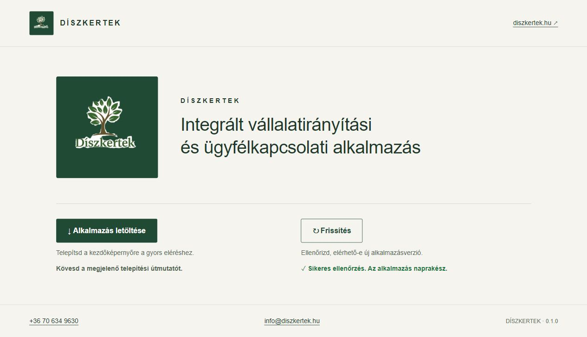
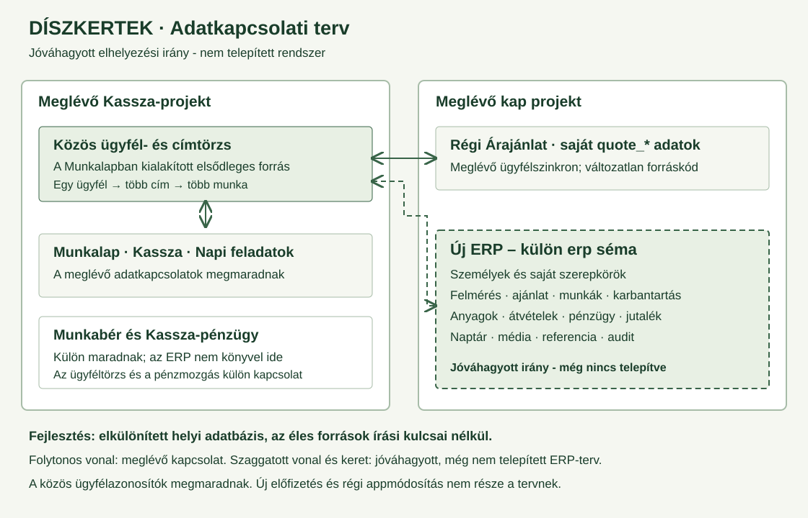
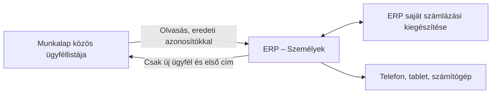

# DÍSZKERTEK

**Integrált vállalatirányítási és ügyfélkapcsolati alkalmazás**

Ez a repository a teljes Díszkertek ERP fejlesztésének és dokumentációjának önálló helye. A követelmény az eredeti, 15 oldalas fejlesztői PDF teljes funkcióköre, a kiegészítésben és a megrendelővel egyeztetett módosításokkal.

## Jelenlegi állapot – 2026. november 1.

**A jelenlegi verzió 0.2.0:** az ügyfél kiválasztása után konkrét munkavégzési címhez rögzíthető kertépítési előkészítés és karbantartási igény. A karbantartást az iroda jóváhagyott munkanappal véglegesíti; utána adhatók hozzá megbízások. A kertépítés indítását az elfogadott árajánlat feltétele védi. Emellett az Ügyfelek menüben elérhető a Munkalap közös ügyfélnyilvántartása, két karaktertől ékezetfüggetlen lenyíló kereséssel, ABC-sorrendű találatokkal és összecsukható adatlapokkal. Az iroda új ügyfelet és címet vehet fel a közös listába, a külön engedélyezett új adatok mentésével. Meglévő forrásadatot nem írunk át. Ági és Tamás saját ERP-belépése és a D betűs ikon megmarad. A teljes ERP többi üzleti modulja még fejlesztés alatt áll.

[Alkalmazás megnyitása](https://agnesgeller.github.io/erp/) · A webcímen az index.html jelenik meg, a műszaki dokumentáció itt, a GitHubon olvasható.

A teljes adatbázisterv további, még nem telepített modulokat is tartalmaz. A ténylegesen elkészült ügyfélkapcsolatot az ügyfélnyilvántartási leírás, a belépést a saját dokumentációja rögzíti. Az eredeti munkafüzeteket, ügyféladatokat és adatbázis-mentéseket nem töltjük a repositoryba.

## Röviden, nem fejlesztőknek

A dolgozók az átállásig a mostani alkalmazásaikat használják. Az új rendszerben az ügyfél felvételétől a helyszíni felmérésen, ajánlaton és munkavégzésen át az elszámolásig, fizetésig és referencia elkészítéséig követhető lesz a munka.

Egy ügyfélnek több munkavégzési címe lehet. Egy címhez több kertépítés és karbantartás tartozhat. Az ügyfél neve, az elvégzett munka értéke és a tényleges befizetés külön adat: ezeket összekapcsoljuk, de nem számoljuk kétszer ugyanazt az összeget.

Az ábra tervet mutat. A szaggatott vonalak még nem létező ERP-kapcsolatokat jelölnek.

## Dokumentáció

- [Részletes adatbázisterv](docs/adatbazisterv.md): elhelyezés, táblák, jogosultságok, szinkron, pénzügyek, mentés, átállás, ellenőrzések.
- [A csatolt árajánlat-kalkulátor felmérése](docs/kalkulator-felmeres.md): ellenőrzött képletek, 163 árlistasor, 22 kategória, sablonok és megfeleltetési problémák.
- [Ügyféllisták összevetése](docs/ugyfellista-egyeztetes.md): Munkalap, Kassza, Napi feladatok és ERP darabszámai, szűrései és eszközfrissítése.
- [Ügyfélnyilvántartás és közös lista](docs/ugyfelnyilvantartas.md): használat, szinkron, engedélyezett új ügyfélmentés és hibakezelés.
- [Címhez kapcsolódó munkák](docs/cimhez-kapcsolodo-munkak.md): rögzítés, karbantartás jóváhagyása, állapotok, adatvédelem és a kertépítés ajánlati feltétele.
- [Munkánkénti szerepkörök](docs/szerepkorok.md): Építésvezető, Karbantartásvezető, Kertépítő, Kertész; szerveroldali korlátok és ellenőrzések.
- [Aktuális irodai belépés](docs/irodai-belepes.md): Ági és Tamás saját ERP-fiókja, megjegyzett munkamenet, ellenőrzés.
- [A 0.1.4 belépési alap történeti leírása](docs/belepes-es-jogosultsagok.md): használat, adatvédelem, telepített szerveroldal, ellenőrzések és korlátok.
- [Fejlesztési napló és döntések](docs/fejlesztesi-naplo.md): mi készült el, mi jóváhagyott, mi vár döntésre, és hogyan ellenőriztük.

## Menthető PDF-változatok

- [Részletes adatbázisterv - PDF](output/pdf/01_Diszkertek_reszletes_adatbazisterv.pdf)
- [Magyar README és adatkapcsolati ábra - PDF](output/pdf/02_Diszkertek_magyar_README.pdf)
- [Kalkulátor-felmérés és fejlesztési napló - PDF](output/pdf/03_Diszkertek_kalkulator_es_fejlesztesi_naplo.pdf)

A PDF-ek a dokumentáció menthető pillanatképei. A továbbfejlesztéshez az aktuális Markdown-forrásokat is meg kell őrizni.

## Jóváhagyott irányok

- Magyar felület és folyamatosan magyar nyelvű README, használati és továbbfejlesztési leírással.
- HTML5, CSS3 és moduláris TypeScript már az első alkalmazásverziótól; Supabase PostgreSQL és TypeScript szerveroldali műveletek.
- Teljes PDF-funkciókör: a mérföldkövek munkasorrendet jelentenek, nem csökkentett végterméket.
- A weboldalon háttér nélküli Díszkertek-logó; a favicon és a telepített alkalmazás ikonja zöld négyzetben nagy, középre helyezett fehér D betű (a 2026. november 1-jei kérés szerint).
- Megjelenő név: DÍSZKERTEK. Felirat: „Integrált vállalatirányítási és ügyfélkapcsolati alkalmazás”.
- Elérhetőségek: +36 70 634 9630; info@diszkertek.hu; www.diszkertek.hu.
- Az új arculat és dokumentumsablonok kizárólag a jóváhagyott Díszkertek-megjelenést használják. A forrásfájlok régi készítői feliratait nem emeljük át.
- A repositoryt és a deploymentet a megrendelő kezeli. Ellenőrzött fejlesztésekhez automatikus commit és push engedélyezett.
- Az ERP a kap Supabase-projektben, saját erp és erp_private sémákkal működik. A KAP és Árajánlat tesztalkalmazások adatait és meglévő fiókjait nem használjuk fel. Az ERP saját ügyfélnyilvántartást kap; később külön, ellenőrzött adatimport készül.
- Irodai hozzáférés: Ági és Tamás külön ERP-fiókja. Az info@diszkertek.hu a cég elérhetősége; nem ebből következtetünk más alkalmazások fiókjaira vagy jelszavaira.
- Új előfizetés nem indítható. Használati díjas külső szolgáltatás sem aktiválható előzetes egyeztetés nélkül.

## A meglévő működés védelme

A Kassza, Munkabér, Munkalap és Napi feladatok forráskódja és meglévő adatbázis-objektumai ebben a munkában nem módosulnak. A Munkalap és Napi feladatok adatai későbbi, külön ellenőrzött átvétel forrásai lehetnek. A jelenlegi lépés nem olvas vagy importál üzleti adatokat belőlük.

A Kassza és a Munkabér pénzügyi funkcióit nem integráljuk az ERP-be. Az ERP saját elszámolásokat, befizetés-visszaigazolásokat és jutalékanalitikát kezel. Az ügyféladatok későbbi átvételének módját külön, forrásazonosítókkal és ellenőrzésekkel dokumentáljuk.

A munkatársak közötti pénzátadás és pénzátvétel nem számít új céges bevételnek vagy költségnek.

## Adatvédelem és GitHub

A frontend kódja publikus tárhelyen is megjelenhet. Sem ügyféladat, sem belső árlista, hang, munkalap, PDF, eredeti Excel, adatmentés, API-titok vagy jelszó nem kerülhet a repositoryba. A tényleges árlista hitelesített, jogosultságokkal védett importtal kerül majd az adatbázisba.

A forrásokból átvett számítási szabály és a belső adat két külön dolog. A matematikai logika tesztelhető kitalált tesztértékekkel; ilyen tesztadat a végfelhasználói felületen nem jelenhet meg.

## Hogyan folytatható a fejlesztés?

1. A fejlesztési napló és a teljes adatbázisterv elolvasása.
2. A jóváhagyott elhelyezési irány műszaki megvalósítása és elkülönített jogosultsági tesztjei; ellenőrzés nélkül nincs éles telepítés.
3. Elkülönített helyi fejlesztőkörnyezet létrehozása, a régi alkalmazásokhoz írási kapcsolat nélkül.
4. A PDF szerinti funkciók megvalósítása TypeScriptben, ellenőrizhető mérföldkövekkel.
5. Minden változtatásnál az érintett funkció, indok, teszt, korlát és adatbázishatás dokumentálása.
6. Futtatható frontend elkészültekor pontos indítási, build- és GitHub-deployment leírás, valamint tényleges képernyőképek hozzáadása.
7. Éles átállás csak mentés, tesztimport, teljes jogosultsági ellenőrzés és külön jóváhagyás után.

## Fejlesztés, ellenőrzés és GitHub Pages

Node.js 20.12 vagy újabb szükséges. Mindig az **erp repository saját könyvtárában** dolgozz; csomagtelepítés előtt ellenőrizd az npm prefix eredményét.

1. `npm ci` – kizárólag helyi fejlesztői függőségek telepítése, nincs fizetős szolgáltatás.
2. `npm run build` – a src mappa TypeScript-moduljainak fordítása az assets/js mappába. A fordított fájl is verziókezelt, a Pages nem igényel Node.js futtatást.
3. `npm test` – telepítés/frissítés, adatbázis-jogosultságok, kiszolgáló, munkamenetek és dátumkezelés; `npm run check:edge` – az ERP-kiszolgáló szigorú TypeScript-ellenőrzése.
4. `python tools/preview.py --port 5194` – helyi megnyitás: http://127.0.0.1:5194/erp/. Az előnézet kizárólag az ERP publikus fájljait szolgálja ki. A teszt végén Ctrl+C-vel állítsd le.
5. Commit és push közvetlenül a main ágra, majd a Pages-telepítés ellenőrzése. A forrás a main ág gyökérmappája; az index.html az alkalmazás kezdőlapja, a .nojekyll kikapcsolja a dokumentációs Jekyll-feldolgozást.

Új kiadáskor minden verziózott HTML-, CSS- és JS-hivatkozást, dinamikus modulimportot, manifest start_url értéket, SW-listát és tesztet is össze kell hangolni. A manifest id és scope értéke állandó /erp/ marad. Együtt módosítandó: package.json és package-lock.json verziója, version.json, src/main.ts két verziószövege és sw.js CACHE_NAME értéke; ezután újrafordítás és teszt.

## Letöltés és frissítés használata

- **Alkalmazás letöltése:** a böngésző saját telepítőjét nyitja meg, ha támogatott és elérhető. Sikeres telepítéskor zöld pipa jelenik meg. Az ablak elfogadása önmagában még nem jelenti a telepítés befejezését.
- Ha nincs közvetlen telepítő, magyar útmutató segít. iPhone/iPad esetén Safari → Megosztás → Főképernyőhöz adás. Ez nem külön APK vagy alkalmazásbolti kiadás.
- **Frissítés:** interneten ellenőrzi a kiadást és a service workert. Ha nincs új verzió, zöld pipás „Sikeres ellenőrzés. Az alkalmazás naprakész.” jelzés látszik. Elérhető frissítés betöltése után „Sikeres frissítés.” jelenik meg.
- Hálózati vagy telepítési hibánál nincs téves sikerjelzés; a gomb újra használható.
- Kizárólag a saját ERP statikus fájljai kerülnek gyorsítótárba. Ügyféladatot, API-választ és más alkalmazás gyorsítótárát ez a verzió nem tárolja és nem módosítja.

A tényleges Chrome/Edge és iOS kezdőképernyős telepítést még külön eszköztesztnek kell igazolnia. Az alkalmazáson belüli böngészőben a telepítési útmutató és a frissítésellenőrzés működését ellenőriztük.

## Ikonok és dokumentáció újraelőállítása

Az aktuális alkalmazásikon és favicon zöld alapon nagy fehér D betű. Újragenerálás az ERP mappájából: `python tools/generate-app-icons.py` (Pillow és Windows Arial Bold szükséges; a webalkalmazás ezeket nem tölti be). A PNG-k új, verziózott fájlneveket kaptak, a korábbi képek megmaradtak. A weboldal logója és a megosztási előnézet továbbra is a Díszkertek-logót mutatja; ezek korábbi előállítója a tools/generate-icons.mjs.

A három PDF újraelőállítása: `python tools/render-docs.py` (reportlab szükséges; magyar Arial betűkészlettel). Kimenet: output/pdf. A képernyőképek valódi böngészős felvételek.

A kap projekt Árajánlat alkalmazása friss **tesztalkalmazás**. Az új ERP elkészülése és az átvétel ellenőrzése után eltávolítható, a már kiküldött PDF és a szükséges adatok megőrzésével. Ebben a fejlesztési lépésben nem töröltünk belőle semmit.

### 0.1.1 – Logómegjelenítés pontosítása

A fejlécben és a kezdőfelületen az eredeti átlátszó logó jelenik meg, zöld négyzet nélkül. A favicon, a telepítési ikonok és a linkelőnézet változatlanok. A korábbi PDF-ek és képernyőképek az első változat pillanatképei.

### Megosztási előnézet pontosítása

A megosztási kép világos hátterű, nagy, eredeti Díszkertek-logóval. A név és a teljes alkalmazásleírás a link metaadataiban szerepel; a képen nincs ismételt apró felirat. Az új megosztas-v2.png képnév segíti a frissítést. A már elküldött Viber-üzenetek előnézetét a Viber saját gyorsítótára őrizheti; ezek utólagos frissülése nem garantálható.

### 0.1.2 – Felső alkalmazásmenü

A Telepítés és Frissítés gomb a felső menüben, bejelentkezés előtt is elérhető. Mobilon két legalább 48 képpont magas gomb jelenik meg. A telepítőablakot támogató böngészőben a saját telepítő nyílik meg; más környezetben iPhone/iPad, Android, Mac, asztali gép vagy beágyazott böngésző szerinti lépések láthatók. A sikeres telepítést csak visszaigazolás után jelezzük. A natív telepítés böngészőfüggő; a reszponzív webes működés ettől független.

### 0.1.3 – Saját ERP-telepítési azonosító

A működő Napi feladatok, Munkalap, Kassza és Munkabér forrását kizárólag olvasással hasonlítottuk össze. Az ERP a Napi feladatok mintájára kifejezett **/erp/** telepítési azonosítót kapott. A korábbi ./ azonosító a manifest szabványa szerint a domain gyökerére oldódott fel, ezért másik appal azonosnak minősülhetett. A scope is /erp/; ez a két beállítás eltérő szabályok szerint oldódik fel.

A Munkalap és a többi működő app mintájára az indítóoldal, a CSS, a JavaScript, a manifest és a service worker verzióparamétert használ. A Frissítés csak a kért verzió tényleges betöltése után jelez sikeres frissítést. Az ERP kizárólag saját gyorsítótárát kezeli.

[Részletes telepítési összehasonlítás](docs/telepitesi-osszehasonlitas.md). Helyi, a valódi /erp/ útvonalat követő előnézet: `python tools/preview.py`, majd http://127.0.0.1:5194/erp/. Az előnézet más appok mappáit nem szolgálja ki.

Ellenőrzés: TypeScript-build, 14 célzott automatikus teszt, böngészős frissítésellenőrzés. A valódi Chrome/Edge telepítés befejezését külön eszközpróba igazolhatja; az eseményszimuláció ezt nem helyettesíti.

### 0.1.4 – Irodai belépés és munkánkénti megbízások (korábbi állapot)

1. Ez a korábbi változat a meglévő info@ fiókhoz kapcsolta az ERP-tagságot. Ez az összerendelés megszűnt; az új belépéshez Ági vagy Tamás nevét kell választani, saját ERP PIN-kóddal. Jelszót ne küldj üzenetben. Új jelszó, automatikus meghívó vagy jelszó-visszaállító e-mail ebben a lépésben nem készült.
2. Az irodai munkatérben felvehető munkatárs. Ez egy személy nyilvántartásba vétele; önmagában nem hoz létre bejelentkezési fiókot.
3. Meglévő ERP-munkánál munkatárs, szerepkör és időszak választható. Több ember lehet vezető egyszerre, és egy ember több munkán is dolgozhat. A visszavonás előzménye megmarad. **Még nincs importált vagy létrehozott ERP-munka**, ezért a megbízásűrlap csak a munkák későbbi felvétele után jelenik meg.
4. A jelszót és a belépési tokeneket nem mentjük a böngésző tartós tárhelyére. Oldal-újratöltés vagy alkalmazásfrissítés után ismét be kell lépni. A Kijelentkezés csak ezt az ERP-munkamenetet zárja le.

A felső Telepítés és Frissítés gomb belépés előtt és után is elérhető. A fejlesztés során 44 automatikus teszteredmény sikeres, köztük az ERP-adatok szervezeti elkülönítése, az azonnali jogosultság-visszavonás és az ismételt munkatársmentés védelme. A valós jelszavas belépés, a munkák adatimportja és az ügyfélportál még külön ellenőrzési/fejlesztési lépés. Részletek: [belépés és jogosultságkezelés](docs/belepes-es-jogosultsagok.md).

### 0.1.5 – Ági és Tamás saját irodai belépése

1. Nyisd meg az alkalmazást, és szükség esetén használd a felső **Frissítés** gombot.
2. A **Név** mezőben válaszd Ágit vagy Tamást.
3. Add meg a személyhez beállított **saját ERP PIN-kódot**, majd válaszd a **Belépés** gombot. A PIN-ek nem szerepelnek a dokumentációban vagy a forrásban.
4. Ugyanazon eszközön, ugyanabban a böngészőben a következő megnyitáskor a rendszer az ERP saját munkamenetét megújítja, ellenőrzi a jogosultságot, és automatikusan megnyitja a munkateret. Ehhez internetkapcsolat és engedélyezett böngészőtárhely szükséges.
5. A **Kijelentkezés** elfelejti az ERP-belépést ezen a böngészőn. Másik böngészőben vagy új eszközön először ismét szükséges a saját PIN.

A telefon/desktop jelszókezelője külön is felajánlhatja a kód mentését; ezt a böngésző beállításai szabályozzák. Az automatikus ERP-megnyitás a megjegyzett munkameneten alapul. Az ügyfél/dolgozói e-mailes regisztráció és jelszó-visszaállítás most nincs bekapcsolva.

Ellenőrzés: 73 sikeres automatikus teszteredmény; mindkét valódi ERP-fiók HTTPS-belépése, irodai adatolvasása és saját kijelentkezése sikeres. A beépített ellenőrző böngésző a külső API-hoz kapcsolódási hibát jelzett; a saját Chrome/Edge eszközön történő első belépést és újranyitást ezért külön ellenőrizni kell.

### 0.1.6 – A böngészős belépés javítása (2026. november 1.)

A hálózati kérés hibás hívási környezetben indult: a fetch függvényt az ERP API-objektum saját metódusaként hívtuk. A böngésző ezt Illegal invocation hibával elutasította, a felület pedig tévesen egyszerű kapcsolódási hibát jelzett. A javítás a megfelelő böngészőkörnyezethez köti a fetch hívását. Az időkorlát AbortControllerrel működik, AbortSignal.timeout támogatás nélkül is.

A célzott teszt már a natív böngésző által elvárt hívási környezetet is ellenőrzi. Ági és Tamás valódi böngészős belépése, az újratöltés utáni automatikus belépés és a kijelentkezés sikeresen ellenőrizve a helyi javított felületen. A PIN-ek, fiókok, adatbázis-szabályok és más alkalmazások nem változtak.

Az éles 0.1.6 kiadásban mindkét irodai fiók belépése és újratöltés utáni automatikus belépése sikeres. A felső Frissítés után a 0.1.6 töltődött be, sikeres frissítés és automatikus belépés jelzéssel. Összesen 75 automatikus teszteredmény sikeres. A README képe a nyilvánosan látható belépési oldalt mutatja; belépett munkatér képe nem kerül a nyilvános repositoryba.

### 0.1.7 – Jól olvasható D betűs ikon (2026. november 1.)

A kis méretben nehezen felismerhető logó helyett a telepített ERP ikonja és a favicon most egyszerű zöld négyzet, közepén nagy fehér D betűvel. A 32, 180, 192 és 512 képpontos képek új fájlnevet kaptak, hogy az új képet kérje a böngésző. A weboldal teljes logója és a megosztási kép nem változott.

Az alkalmazás felső **Frissítés** gombjával tölthető be a 0.1.7. A már telepített Windows-ikon frissítését a Chrome külön kezeli; az oldal sikeres frissítése nem igazolja az operációs rendszer ikonjának cseréjét. A Chrome név- vagy ikonváltoztatáskor megerősítést is kérhet ([Google útmutató](https://support.google.com/chrome/answer/9658361?hl=hu&co=GENIE.Platform%3DDesktop)).

A felhasználó visszajelzése szerint a korábban telepített KM eltávolítása után az ERP telepítése sikerült. Ezt ő végezte; a fejlesztés más alkalmazást vagy böngészős telepítést nem módosított. A jelenlegi ERP azonosítója és hatóköre továbbra is /erp/. Újratelepítés és közös böngészőadatok törlése nem része az ikonfrissítésnek.

Ellenőrzés: sikeres TypeScript-build, 14 sikeres célzott PWA-teszt és az új ikon vizuális ellenőrzése. A felhasználó Windows-tálcáján megjelenő új ikon még külön visszaigazolást igényel.
### 0.1.8 – Közös ügyfélnyilvántartás

A **Személyek → Ügyfelek** két karaktertől automatikusan felkínálja a megfelelő ügyfeleket. Az ékezetek és a kisbetű/nagybetű nem számítanak; a találatok magyar ABC-sorrendűek. Az adatlap, a címek, a kapcsolattartók, a számlázási kiegészítés és az új ügyfél mezőcsoportjai összecsukhatók. A munkatársak is ABC-sorrendű lenyíló listában választhatók.

A jelenleg ellenőrzött Munkalap-forrás 155 ügyfelet tartalmaz: 152 nem archivált és 3 archivált, 157 címmel. Az archivált ügyfelek külön kapcsolóval megjeleníthetők. Eredeti ügyfél- és címazonosítójuk megmarad. A megrendelő külön engedélye alapján az ERP új ügyfelet és első címét is elmentheti ebbe a közös listába. Meglévő forrásügyfelet, címet vagy munkalapot nem ír át.

Az ERP aktív ügyfélnézetben 30 másodpercenként frissít, ha nincs nem mentett szerkesztés. A régi appok saját következő adatbetöltésükkor látják az új ügyfelet; már nyitott régi felületen szükség lehet annak saját frissítésére. A jelenlegi lépés nem változtatja meg a régi appok működését.

A megszakadt újügyfél-mentés tartósan megmarad, és ugyanazokkal az azonosítókkal folytatható. A részletes használat, a biztonsági határok és az ellenőrzés: [Ügyfélnyilvántartás](docs/ugyfelnyilvantartas.md).
A külön ellenőrzés szerint a Kassza 152 aktív, nem archivált ügyfelet, a Napi feladatok 149 jóváhagyott ügyfelet kér le ugyanebből a közös törzsből. A három ügyfél eltérése jóváhagyási szűrésből ered; nem módosítottuk a rekordokat. Részletek: [ügyféllisták összevetése](docs/ugyfellista-egyeztetes.md).

### 0.1.9 – A PDF szerinti munkaszerepkörök

A Munkák és megbízások lenyílóban **Építésvezető, Karbantartásvezető, Kertépítő és Kertész** választható. A két vezető a megfelelő munkaterületén kap vezetői jogosultságot; a két dolgozói szerep jogosultsága azonos és mindkét területen használható. Szerepet csak az iroda oszthat. Külön Projektvezető nincs.

A választó és az adatbázis is ellenőrzi a munka típusát. Több vezető és több szerep lehetséges. Munka kiválasztása nélkül a szerepek megtekinthetők, de mentés nem indítható. A teljes ellenőrzés 106 sikeres teszteredményt adott. Részletek és a jelenlegi funkcióhatárok: [munkánkénti szerepkörök](docs/szerepkorok.md).
### 0.2.0 – Munkavégzési címhez kapcsolódó munkák

1. Az **Ügyfelek** menüben keress legalább két karakterrel, majd nyisd meg az ügyfelet.
2. Kattints az **Új munka / igény ehhez az ügyfélhez** gombra, és válaszd ki a pontos munkavégzési címet.
3. Add meg a típust, a megnevezést és a feladatot. A kért nap, létszám és óraszám külön lenyílóban adható meg. Mentsd az igényt.
4. A **Munkák** menüben nyisd le a rögzített tételt. Karbantartásnál add meg a jóváhagyott napot, és hagyd jóvá. Ezután a Munkatársak és megbízások résznél kioszthatók a szerepek.

A kertépítési előkészítés nem indít el munkavégzést: a PDF 12. pontja szerinti elfogadott árajánlat és külön indítás szükséges. Az ajánlatmodul még nem készült el, ezért ennek megkerülését a kiszolgáló és az adatbázis is tiltja. A karbantartási igény a PDF 18. pontja szerinti irodai jóváhagyással véglegesíthető. Naptári kapacitásfoglalást ez a lépés nem végez.

Az új munkák kizárólag az ERP-ben keletkeznek. A közös ügyfél- és címlistát ehhez csak olvassuk; a régi Munkalapba munkát, megbízást vagy állapotot nem írunk. A többi eszköz a központi ERP-adatokat újranyitáskor, fókuszváltáskor vagy a Lista frissítése gombbal tölti be. Nem mentett űrlapot nem írunk felül. A korábbi ügyfélszámok dátumozott ellenőrzési eredmények; a közös lista a napi használat során változhat.
