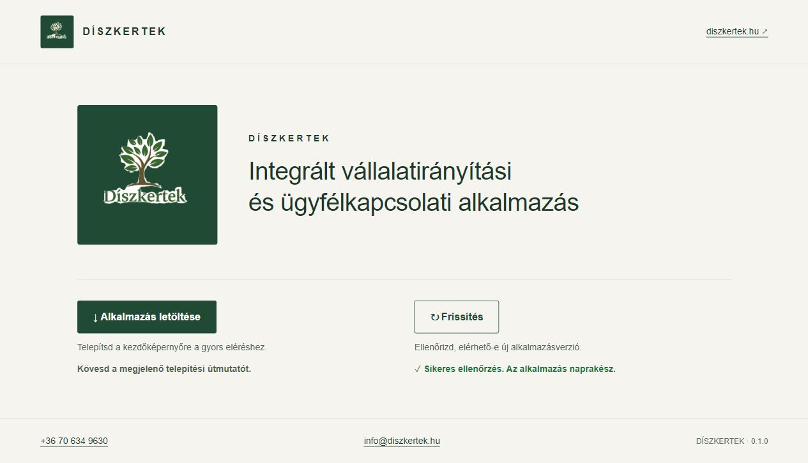

# DÍSZKERTEK

**Integrált vállalatirányítási és ügyfélkapcsolati alkalmazás**

[Alkalmazás megnyitása](https://agnesgeller.github.io/erp/) · **Verzió: 0.6.1**

## Mi használható?

- Saját irodai és ügyfélbelépés; az iroda pipával jelöli ki a látható címeket, a meghívót kézzel küldi.
- Közös ügyféllista, munkavégzési címek, munkák és munkatársi megbízások.
- Helyszíni felmérés: kézi jegyzetek, méretek, helyi fotók/hangok, letölthető csomag és kézi ajánlatátadás.
- Árajánlatkészítés: 163 árazott típus, 22 kategória, három sablon, frissülő PDF-előnézet, tételtörlés/visszavonás és választható kézi levelezés.
- Telepítés és frissítés a felső menüből; mobilon is használható felület.

A részletes munkaterv és négyszintű átvétel fejlesztés alatt áll; [folytatási pont](docs/munkaterv-folytatasi-pont.md).

A járdasablon pontosítandó sorait a főnök ajánlatkészítéskor választja ki. A teljes ERP fejlesztése még folyamatban van; a Groq MI-próbájához saját szerveroldali kulcs szükséges.



## Használat és dokumentáció

- [Irodai belépés](docs/irodai-belepes.md) · [Ügyfélbelépés és saját munkák](docs/ugyfelbelepes.md) · [Ügyfelek](docs/ugyfelnyilvantartas.md) · [Munkák](docs/cimhez-kapcsolodo-munkak.md)
- [Felmérések és helyi fájlok](docs/felmeresek.md) · [Árajánlatok, árlisták és sablonok](docs/arajanlatmodul.md)
- [Adatbázisterv](docs/adatbazisterv.md) · [Jogosultságok](docs/szerepkorok.md) · [Excel-kalkulátor](docs/kalkulator-felmeres.md)
- [Fejlesztési napló](docs/fejlesztesi-naplo.md) · [Részletes projektleírás és előzmények](docs/reszletes-projektleiras.md)
- [A fejlesztői PDF teljesítési állapota és hátralévő modulok](docs/specifikacio-allapot.md)
- [Menthető PDF-pillanatképek](output/pdf/) – korábbi dokumentációs változatok.

A Munkalap az elsődleges ügyféllista. Az ERP új ügyfelet és első címet a külön engedély szerint menthet bele; meglévő forrásadatot nem ír át. A többi alkalmazás kódja és adatbázis-szerkezete változatlan. Ügyféladat, belső árlista és jelszó nem kerülhet a GitHubra.

## Fejlesztés

HTML, CSS és TypeScript; Supabase, saját ERP-sémákkal. Követelmény: az eredeti fejlesztői PDF és a jóváhagyott kiegészítések teljesítése.

Az ERP saját mappájában, meglévő fejlesztői függőségekkel:

```sh
npm run build
npm test
npm run check:edge
```

Legutóbbi célzott ellenőrzés: **2026. november 3., 36 sikeres teszt**, TypeScript-fordítás és helyi böngészőpróba. A teljes üzleti lánc átadási próbája a hátralévő modulok elkészülése után következik.

+36 70 634 9630 · [info@diszkertek.hu](mailto:info@diszkertek.hu) · [www.diszkertek.hu](https://www.diszkertek.hu/)

Számok: fölösleges tizedesnullák nélkül, legfeljebb két tizedessel; a belső számítás pontos marad.
