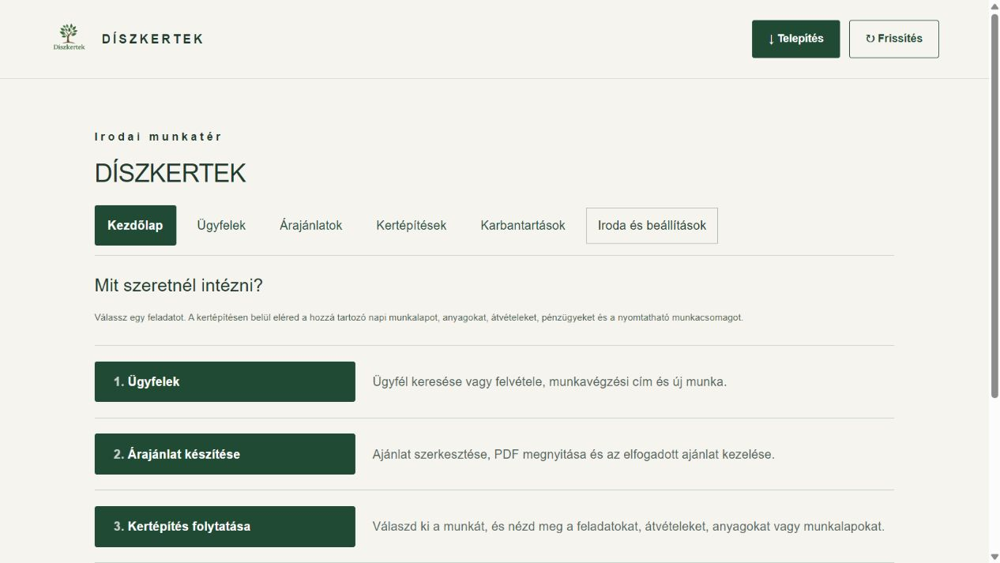

# DÍSZKERTEK

**Integrált vállalatirányítási és ügyfélkapcsolati alkalmazás**

[Alkalmazás megnyitása](https://agnesgeller.github.io/erp/) · **0.15.0 – helyi kiadásjelölt** (online: 0.14.1)

## Mi használható?

- Saját irodai, dolgozói és ügyfélbelépés; munkánkénti megbízás és kijelölt ügyfélcímek.
- Ügyfelek, munkavégzési címek, helyszíni felmérések és helyi fájlcsomagok.
- Excel-alapú árajánlat, árlisták/sablonok, PDF-előnézet és kézi levélküldés.
- Kertépítési szakaszok, részfolyamatok, húzással rendezés, négyszintű átvétel és nyomtatható munkacsomag.
- Saját munkalap, tényleges munkaidő; munkanapi beszállítás/beépítés, közvetlen anyagtörzs és anyagelőrehaladás.
- Előleg, részfizetés, irodai pénzigazolás, kertépítési eredmény és éves jutalék.
- **Kertkarbantartás:** igény, irodai jóváhagyás, napi munkalap, közzétett PDF és elszámolás.
- **Naptár és Napi feladatok:** napi/heti/havi nézet, szerkesztés, PDF, saját mentés és ellenőrzött adatátvétel.
- Telepítés/frissítés a felső menüből; mobilon is használható felület.

A teljes ERP fejlesztése folyamatban van. [Szakaszolás és rendezés – rövid használat](docs/szakaszolas-hasznalat.md). [Állapot](docs/specifikacio-allapot.md) · [Naptár – rövid használat](docs/naptar-napi-feladatok.md).

Az irodai kezdőlapon négy feladat közül választhatsz; a ritkább műveletek az **Iroda és beállítások** alatt találhatók.

## Használati segítség

[Munkacsomag és egyszerűbb menü](docs/munkacsomag.md) · [Karbantartás – rövid kipróbálás](docs/kertkarbantartas.md) · [Pénzügyek](docs/penzugyi-elszamolas.md) · [Munkaterv és átvétel](docs/munkaterv-es-atvetel.md) · [Munkalap és munkaidő](docs/munkalap-munkaido.md) · [Anyagkezelés](docs/anyagkezeles.md)

[Belépés](docs/irodai-belepes.md) · [Ügyfélportál](docs/ugyfelbelepes.md) · [Ügyfelek](docs/ugyfelnyilvantartas.md) · [Árajánlatok](docs/arajanlatmodul.md) · [Felmérések](docs/felmeresek.md)

## Fejlesztés és biztonság

HTML, CSS, TypeScript; Supabase saját ERP-sémákkal. Az eredeti fejlesztői PDF és a jóváhagyott pontosítások az irányadók. A Munkalap az elsődleges ügyféllista; az ERP a külön engedély szerint új ügyfelet és első címet menthet bele. A többi alkalmazást nem módosítjuk. Ügyféladat, valódi árlista és jelszó nem kerülhet a GitHubra.

Az ERP saját mappájában: `npm run build`, `npm test`, `npm run check:edge`.

Legutóbbi ellenőrzés: **2026. november 5., 553 sikeres helyi teszt**, fordítás, kiszolgáló-típusellenőrzés és asztali szintetikus böngésző-/PDF-próba. A mobiljavítás ismételt szemrevételezése a tesztböngésző elakadása miatt még nyitott; élesítés/push nem történt.

[Adatbázisterv](docs/adatbazisterv.md) · [Jogosultságok](docs/szerepkorok.md) · [Fejlesztési napló](docs/fejlesztesi-naplo.md) · [Részletes dokumentáció](docs/reszletes-projektleiras.md)

+36 70 634 9630 · [info@diszkertek.hu](mailto:info@diszkertek.hu) · [www.diszkertek.hu](https://www.diszkertek.hu/)
