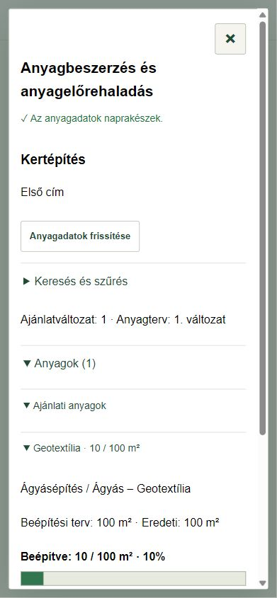

# Anyagbeszerzés és anyagelőrehaladás

ERP 0.10.0 · 2026. november 3. · [Jóváhagyott adatbázisterv](anyagmozgas-anyagelorehaladas-terv.md)

## Megnyitás

Irodai belépés után **Iroda és beállítások → Anyagok és anyagtörzs**. Válaszd ki a kertépítést. A munkatervből az **Anyagbeszerzés és előrehaladás** gomb ugyanezt a munkát nyitja meg, az aktív munkaszereppel.

A már meglévő kertépítésnél az iroda az **Anyagterv betöltése az elfogadott ajánlatból** gombbal készíti el az induló anyaglistát: **Mentési előnézet ellenőrzése → Anyagterv betöltése**. Új elfogadott ajánlatból létrejövő munkánál a terv automatikusan keletkezik. A későbbi, jóváhagyott ajánlatváltozás atomikusan frissíti a mennyiségi tervet, az eredeti terv és a mozgások megőrzésével.

A fizikai mozgás futó kertépítéshez rögzíthető. Indulásra váró munkán az iroda tervezhet, de anyagmozgást még nem menthet.

## Rövid kipróbálás

Egy tesztelésre szánt, elindított kertépítésen, amelynek elfogadott ajánlatában anyag is szerepel:

1. **Anyagok → Ajánlati anyagok → anyagnév**. Ellenőrizd a beépítési és beszerzési tervet. A ráhagyás miatt ezek különbözhetnek.
2. **Megrendelve – új szállítmány**: dátum, megrendelt mennyiség, beszerzési hely; a még nem ismert tényleges ár üresen maradhat. **Mentési előnézet ellenőrzése**, majd a művelet nevét viselő mentőgomb.
3. **Szállítmányok → kiválasztott szállítmány → Megérkezett a telephelyre – átvehető**. Például 100 egységből 60 érkezik. Add meg a tényleges nettó egységárat; ellenőrizd az előnézetet, majd mentsd. A munka Építésvezetői telephelyi teendőt kapnak.
4. Ugyanott **Átvettem a telephelyen**, például 40 egység. Az előnézetben 20 marad a telephelyen és 40 lesz úton. Az iroda is végigpróbálhatja ezeket a belső műveleteket.
5. **Kivitelezés helyszínére szállítva**, például 12 egység; utána **Beépítve**, például 10. Mindkét műveletnél külön előnézet és mentés szükséges. Eredmény: telephelyen 20, úton 28, helyszínen még nem beépítve 2, beépítve 10 egység.
6. Az anyagnál frissülnek a mennyiségek és százalékos sávok. Az **Anyagmozgások és visszavonások** alatt megnyitható a napló; indokkal visszavonható az utolsó beépítés, majd az ellenmozgás visszavonásával visszaállítható. A korábbi események megmaradnak.

Közvetlen helyszíni beszerzéshez az anyagnál **Közvetlenül a helyszínre beszerezve – új szállítmány** használható. Eltérő egységárú részszállítást külön szállítmányként kell felvenni. A tényleges ár későbbi javítása irodai, naplózott művelet.

## Készlet és költség

A megrendelés még nem megérkezett anyag. A telephelyi átvétel még nem helyszínre szállítás. A beépített mennyiség a helyszínre vitt anyag része; nem számoljuk kétszer. Nem vehető át vagy építhető be több, mint az adott állapotban elérhető készlet. A terv túlléphető, de külön megerősítést kér; a százalék 100% fölé is mehet.

A **Belső anyagköltség – csak iroda** külön mutatja a tényleges beszerzési és az elszámolt anyagköltséget. Alapértékek: beépített 100%, helyszíni maradék 70%, még ki nem szállított 0%. Ezek az Anyagtörzs felület **Belső költségsúlyok** gombjával, változatelőzménnyel módosíthatók. Az összehasonlítás alapja az elfogadott ügyfél-ajánlat anyagértéke. Hiányzó árra külön figyelmeztetés van, nem jelenik meg hamis végleges megtakarítás.

A fenti, 1000 Ft/egység beszerzési árú példában 60 000 Ft a teljes beszerzés, de 10 × 1000 + 2 × 1000 × 70% = **11 400 Ft** az elszámolt anyagköltség. A telephely és az úton levő anyag ebben a szabályban még 0%-kal számít. Ez belső anyagkimutatás, nem befizetés, számla vagy készpénzkönyvelés.

## Törzs, összevonás és extra anyag

**Anyagtörzs és beszállítók**: irodai törzsanyag- és beszállítókezelés, várható nettó ár, csomagméret, fuvar-kapacitás. Archiválás az Aktív törzsrekord pipa levételével, visszaállítás visszapipálással történik. Hivatkozott anyag mértékegységét nem cseréljük át más egységre. A törzs változása nem ír át elfogadott ajánlatot vagy tényleges szállítmányárat.

Az ajánlati típus anyagsorában **Választás a közös anyagtörzsből** használható. Két karaktertől keres, ékezetek nélkül is. Az anyagtervnél az iroda a **Törzsanyag és beszerzési felelős** gombbal kapcsolhatja a meglévő sort a közös anyaghoz. Az **Összevont beszerzési lista** azonos törzsazonosító és egység alapján összegez; bizonytalan névegyezést nem olvaszt össze.

**+ Extra anyag**: név/törzsanyag, mennyiség, egység, hely, várható ár és indok. Az iroda vagy a saját futó munkája Építésvezetője veheti fel. A beszerzési igény nem jelent ügyfél által elfogadott fizetős pótmunkát. Ügyfélre terhelés a külön, már meglévő változásjóváhagyásban történik. Jóváhagyás után az iroda az extrát az azonos egységű ajánlati sorhoz kapcsolhatja; a készlet átkerül, dupla igény nélkül.

## Hozzáférés, mentés és letöltés

Az iroda minden saját belső anyagadatot lát. Az Építésvezető saját munkáján a műszaki listát, várható beszerzési árat és a saját maga rögzített tényleges árat láthatja; mások tényleges ára és a belső eredmény rejtett. Kertész/Kertépítő csak műszaki mennyiségeket olvas, beszerzést nem szerkeszt. A megrendelő csak saját engedélyezett munkájának jóváhagyott anyagait és beépítését követheti, belső árat vagy nem jóváhagyott extra beszerzést nem kap.

Minden ablak felül × gombbal zárható. Helyi **Visszavonás / Újra**, személyhez/szervezethez/munkához/szerephez kötött piszkozat és eredeti kéréses újrapróbálás védi a módosítást. Offline nincs éles készletfoglalás. Ütközésnél **Friss adatok betöltése – a beírt adatok megőrzésével**, majd új előnézet használható; a rendszer nem írja felül csendben a frissebb készletet.

A megjelenített, jogosultság szerint szűrt listák CSV/JSON formában letölthetők és helyben PDF-be nyomtathatók. Nagy listánál a **További… / Korábbi…** gombokkal lehet lapozni. Másik eszköz frissítéskor, a megnyitott anyagablak automatikusan percenként kap friss adatot, szerkesztés közben megszakítás nélkül.

## Közvetlenül a kertépítési munkanapról

0.14.1-től a **Napi munkalap → Anyagok – beszállítás és beépítés** rész az adott nap tényleges mennyiségeit mutatja. Onnan az iroda az anyagtörzset is megnyithatja. Az anyagkezelő átveszi a munkanapot; a készlet/terv továbbra is a teljes munkát, a napló a kijelölt napot mutatja. A **Minden munkanap anyagmozgásai** feloldja a napszűrést. Frissítéskor a lenyitott anyagrészek nem csukódnak be. [Rövid használat és megőrzési szabály](munkalap-munkaido.md#munkanapi-anyagok--0141).
