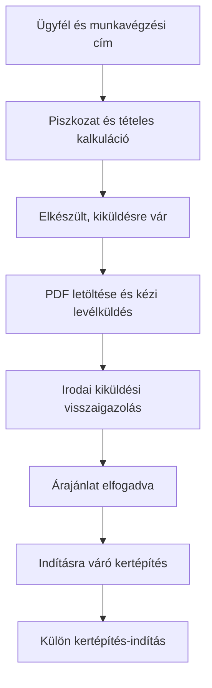

# Árajánlatok, árlisták és sablonok – 0.3.0

Állapot: a konkrét élesítési tervet a megrendelő jóváhagyta, a saját adatbázis és gateway települt; a frontend közzététele a 0.3.0 commit része. Követelmény: a teljes fejlesztői PDF 8–12. pontja és a csatolt Excel-kalkulátor. A Munkalap közös ügyféllistáját ehhez csak olvassuk; az ajánlatok, árak, sablonok és történeti változatok kizárólag az ERP-ben keletkeznek.

## Használat az irodában

1. Az Ügyfelek menüben keresd meg az ügyfelet, nyisd meg az adatlapját, és válaszd az „Új árajánlat ehhez az ügyfélhez” gombot. Az Árajánlatok menüből az Ügyfél kiválasztása ugyanerre vezet.
2. Válassz konkrét munkavégzési címet, add meg az ajánlat megnevezését és az adózási módot: 0%, 27% vagy Alanyi adómentes. Az ügyfél több címe külön választható; mentett ajánlat ügyfél- és címkapcsolata nem cserélhető.
3. Adj hozzá főtételt, nevezd el, majd válassz munkasablont, Kategória → Típus szerinti árlistás sort vagy egyedi tételt. A sorok és árösszetevők lenyithatók. Nem szükséges az egyedi tételt az árlistába felvenni.
4. Töltsd ki a sorhoz szükséges mennyiségeket. A főtétel területét a kompatibilis tételek örökölhetik; a m² nem másolódik automatikusan folyóméterbe. A sor saját mennyiségének kézi módosítása kikapcsolja az öröklést. Az opcionális sor külön pipával vehető ki/be.
5. Az Ajánlat mentése az első piszkozatot hozza létre. Már mentett piszkozatnál a szerkesztés után 2,5 másodperces nyugalmi idővel automatikus mentés is történik. A sikertelen mentés látható hibát ad; nem írjuk felül másik eszköz újabb revízióját.
6. A PDF-előnézet mentés előtti, teljesen kiszámolható ajánlatból is kérhető. A PDF letöltése valódi PDF-fájlt ad. A megjelenítés Kompakt vagy Normál lehet. Hiányzó ár/mennyiség esetén javítandó lista jelenik meg, nem hamis nulla végösszeg.
7. Ellenőrzés után jelöld „Elkészült, kiküldésre vár” állapotúnak. Ez lezárja a közvetlen szerkesztést; visszalépés szerkesztésre külön művelet.
8. A Kézi levélküldés ablakban a címzett az ügyféladatból előkészül, a tárgy és a levélszöveg szerkeszthető. Töltsd le a PDF-et, csatold a saját leveleződben, és küldd el. A levél-előkészítő hivatkozás önmagában nem csatol fájlt és nem küld levelet. A „PDF-et csatolva ténylegesen elküldtem” pipa és a Kézi kiküldés rögzítése csak a megtörtént küldés irodai tényrögzítése; nem levelezőszerver-visszaigazolás.
9. Kiküldés után rögzíthető az ügyfél elfogadása vagy elutasítása. Elfogadáskor saját ERP-kertépítés keletkezik Indításra váró állapotban. A Kertépítés indítása külön, megerősített művelet; csak utána lehet munkatársi megbízást adni. A dolgozók a korábbi alkalmazásaikat tovább használják.

## Az Excel átvétele

Az eredeti munkafüzet nem módosul és nem mentődik újra. A 163 árazott típus 22 kategóriában szerepel; három sablon olvasható a Minták lapról. A forráslap/sorszám, az eredeti megnevezés és a SHA-256 lenyomat megmarad. A segédoszlop #VALUE! értékei nem válnak azonosítóvá. Képleteket vagy makrót nem futtatunk; árhoz a munkafüzet tárolt, kiszámolt numerikus értéke szükséges.

A két füvesítési sablon minden sora pontos típushoz kapcsolható. A Járda építés öt általános megnevezése pontosítandó: Tükör készítés; Szegély építés; Teherhordó réteg készítés; Ágyazó réteg készítés; Besöprés, vibrálás 3x. A megrendelő az ERP sablonszerkesztőjében választja ki a megfelelő típusokat. Addig ezek nem kapnak kitalált árat, és beillesztett, hiányos sorral az ajánlat nem véglegesíthető.

Az Árlisták és sablonok menüben a kategória, típus, mértékegység, ár, minimum, paraméter, munkautasítás, anyag és sablon szerkeszthető/bővíthető. Az Excel-feltöltő az eredeti kalkulátor Adatbázis és Minták lapszerkezetét olvassa. Import után előbb ellenőrizhető a szerkesztési változat; csak a Változat mentése véglegesíti. A korábbi árlistaváltozat megmarad. Tetszőleges beszállítói Excel eltérő oszlopainak automatikus megfeleltetését nem állítjuk; a feltöltő az ismert formátumot ellenőrzi.

A beágyazott képeket és a készítői/céges feliratokat nem emeljük át. Az üzleti árlista kizárólag irodai hitelesítéssel tölthető be; nincs publikus statikus árlista. A helyi import köztes állománya a Git által kizárt .local mappában van.

## Számítási szabályok

- Excel mód: első mennyiség × anyag-/munkadíj-egységár; második mértékegységnél mindkét mennyiség szorzata. Az ügyfél-PDF a helyes első mennyiséget és a második tényezővel módosított egységárat mutatja, a második tényezőt megjegyzésként feltüntetve.
- Terület: hossz × szélesség. Térfogat: terület × cm / 100. Növény: terület × db/m², egész darabra felfelé. Réteges díj: terület × (alapár + cm-felár), külön anyagra és munkára.
- Egyedi típus: 1–16 saját paraméter, explicit mértékegység, alapérték, főtételből átvétel és mennyiségképlet. Opcionális anyag-/munkaösszeg-képlet. A matematikai nyelv kizárólag mezőnevet, számot, +, -, *, / műveletet és zárójelet enged. Nincs eval, programkód vagy tetszőleges függvényhívás. Hossz/mélység/mérethatár és nullával osztás elleni védelem működik.
- Anyagösszetevők: főanyag + segédanyag + szállítás; külön munkadíj. A komponensminimumok után érvényesülhet a teljes minimum. A teljes minimum kiegészítésének anyag-/munkadíj-bontását az iroda kifejezetten választja ki; nincs rejtett automatikus szétosztás. A PDF jelzi a minimumdíj-kiegészítést.
- Rögzített pontosság: hat tizedesű egészalapú BigInt számítás, soronként két tizedesre kerekített anyag/munkadíj, a teljes ÁFA-vetítési alapból számolt és két tizedesre kerekített ÁFA. A 27% bruttó szorzó 1,27; 0% és AAM esetén nincs hozzáadott ÁFA. A program nem hoz adójogi döntést a megjelölésről.
- A belső tervezett emberperc = munkadíj / ügyfélnek számlázott Ft/főóra × 60. Hiányzó óradíjnál nem adunk kitalált időt.
- Anyagonként külön beépítendő és ráhagyással növelt, csomagméretre felfelé kerekített beszerzendő mennyiség van. A kapacitásból fuvarszám számolódik. A beszerzési hely, belső ár és felelős csak belső adat. A CSV-export az ajánlat soraihoz kötött belső anyaglista; projektbeli tényleges készletmozgást nem helyettesít.

## PDF és adatvédelem

Kötelező sorrend: Díszkertek és megrendelő adatai → főösszesítő → ÁFA vetítési alap / bruttó → Az ajánlatra vonatkozó információk → főtételenként részletes költségvetés. A4, ismétlődő táblázatfejléc, magyar ékezetes beágyazott betűkészlet, oldalszámozás, hosszú szöveg tördelése, Kompakt/Normál nézet. Készpénzátvételi elismervény és aláírási szakasz nincs.

Az ügyfél-PDF a számított eredmény külön engedélylistás vetületéből készül. Belső munkautasítás, beszállító, belső beszerzési egységár, ráhagyás, beszerzendő mennyiség, óradíj és tervezett idő nem kerül bele. Az anyagmegnevezés és a ténylegesen beépítendő mennyiség szerepelhet. Az irodai API szándékosan részletesebb; ügyfélnek nyilvános ajánlati API-t vagy megosztási tokent ez a lépés nem hoz létre.

## Változatok és hibakezelés

Minden mentés új, vissza nem írt ajánlatverziót ad. Az aktuális változat az alapnézet; alatta tételes változások és események láthatók. Kiküldött ajánlat csak külön revízió után szerkeszthető; elfogadott ár nem írható át. Elfogadott megállapodás pénzügyi módosítása a külön változáskérelem-modul feladata, ezt a szerkesztő nem kerüli meg.

Kérésazonosító, adatbázis-sorzár és revízióellenőrzés védi a mentést és a kézi kiküldési visszaigazolást. Elveszett mentési válasz vagy sikertelen visszaolvasás után ugyanaz a kérés folytatódik, nem új ajánlat keletkezik. Közben tovább szerkesztett mezőt a későn érkező válasz nem dob el. Kijelentkezés után késői adat nem jelenik meg. Lapelhagyás, frissítés és szerkesztésváltás védi a nem mentett adatokat.

## Technikai folytathatóság és ellenőrzés

- Frontend: src/erp-quotes.ts; közös számítás: src/erp-quote-engine.ts; Excel-olvasó: src/erp-calculator-import.ts.
- A tools/build.mjs a saját edge könyvtárba generálja a számítási motor azonos másolatát, majd TypeScriptet fordít. Nincs szülőmappás npm-művelet vagy új helyi csomagtelepítés.
- Backend: saját erp-gateway quotes.ts és quote-pdf.ts. A normál olvasó RPC az RLS-t meg nem kerülő erp_api tulajdonában fut; a számított írás csak kiszolgálói művelet, frissen ellenőrzött aktív irodai tagsággal.
- Két célzott PDF-könyvtár: pdf-lib 1.17.1, @pdf-lib/fontkit 1.1.1; betűkészlet: Noto Sans, OFL-licenccel. Excel ZIP-olvasás: fflate 0.8.2, MIT-licenccel. Felületi keretrendszert nem vezettünk be.
- Teljes regressziós készlet az új célzott kiegészítésekkel: 151 teszteredmény. Külön 163/163 forrásárlistás összevetés. A szintetikus 18 soros ajánlat Kompakt és Normál A4 PDF-je két oldal, magyar ő/ű ékezetekkel, belső adatok nélkül; vizuálisan is ellenőrizve.
- Éles próbaügyfél, próbaajánlat vagy próbakertépítés nem készült. A régi alkalmazások kódja, adata és jogosultsága érintetlen.

A felmérésből indítás és a felmérés MI-feldolgozása a külön Felmérések modul kapcsolódása; a jelenlegi ajánlat kézzel és sablonból szerkeszthető. MI-szolgáltatást vagy fizetős előfizetést ez a változás nem kapcsol be.
