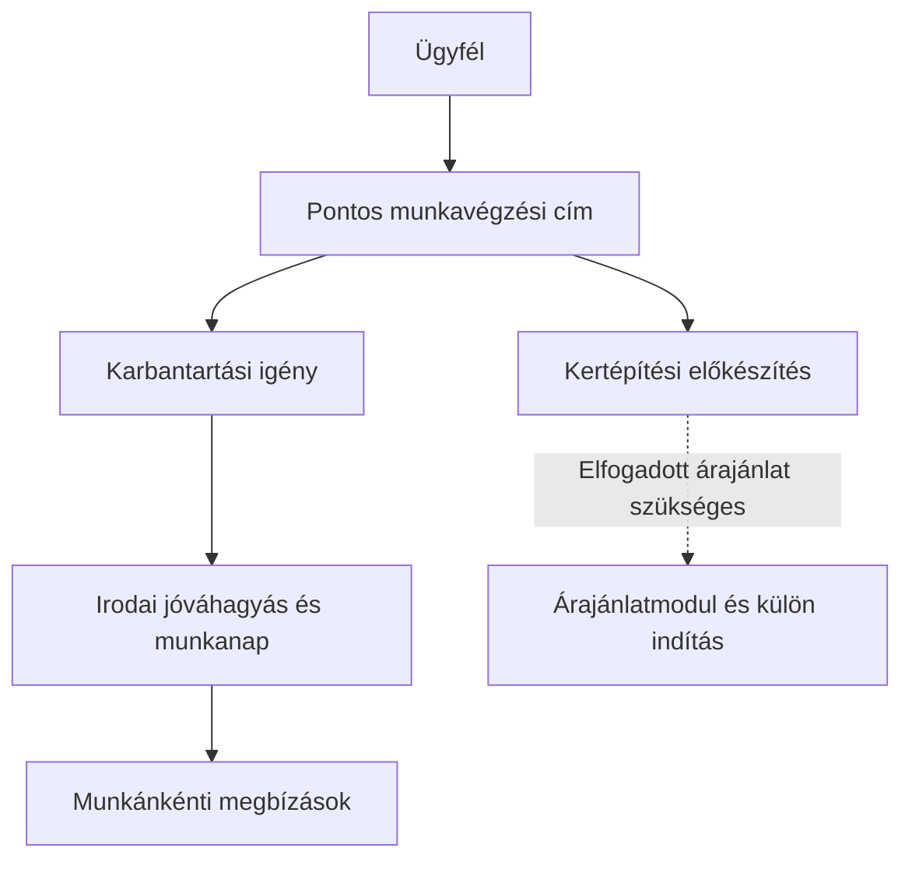

# Címhez kapcsolódó munkák – 0.2.0

A kiindulópont az eredeti fejlesztői PDF 12. és 18. pontja. A kertépítés elfogadott ajánlatból, külön indítással indulhat; a karbantartás igényként érkezik, amelyet az iroda hagy jóvá. A jelenlegi lépés az igényrögzítést és a karbantartás irodai véglegesítését valósítja meg. A teljes árajánlat-, munkanapló-, átvételi és elszámolási folyamat további, az eredeti megbízás részeként elkészítendő modul.

## Használat

Az Ügyfelek menüben keress, válaszd ki az ügyfelet, és nyomd meg az „Új munka / igény ehhez az ügyfélhez” gombot. A címválasztó kizárólag az adott ügyfél aktív, jóváhagyott címeit kínálja. Több címnél kötelező külön választani; egyetlen címnél az előre kiválasztott címet is ellenőrizd. Hiányzó vagy nem jóváhagyott címnél a mentés tiltott, a felület érthető üzenetet ad. Meglévő forrásügyfélhez új cím létrehozása ebben a lépésben nem engedélyezett.

A megnevezés kötelező, a feladatleírás legfeljebb 4000 karakter. A kért nap, létszám és óraszám elhagyható. A kért nap igény, nem végleges kapacitásfoglalás. Minden új igény először inaktív. Karbantartásnál az iroda konkrét napot hagy jóvá; ekkor aktív lesz, a megbízásválasztóban megjelenik. A megbízás önálló művelet marad. A még nem véglegesített igény visszavonható; nem törlődik, előzménye megmarad.

A szaggatott kapcsolat még nem elkészült ajánlatmodult jelöl. A kertépítés jóváhagyása ajánlat nélkül sem a felületről, sem közvetlen RPC-hívással nem lehetséges. Nem állítjuk, hogy a teljes kertépítési folyamat elkészült.

## Adatok és jogosultságok

- Saját `erp.work_sites` tábla őrzi az ellenőrzött forráscímazonosítót, ügyfélazonosítót és címadatot. A forrás felé csak GET történik. A tükör saját ERP-adat; nem közös forrástábla.
- Az `erp.garden_projects` az egyes címhez tartozó ERP-munkát/igényt tartja: típus, állapot, feladat, kért adatok, jóváhagyott nap, forrásügyfél- és címazonosító, létrehozó, időbélyeg, revízió.
- Összetett idegen kulcs tiltja más ügyfél címének használatát. A munka eredeti ügyfél- és címpillanatképe nem változik meg attól, hogy később javítják a forráscímet. Az azonosítók biztosítják a kapcsolatot; név alapján nem egyesítünk személyeket.
- Új rögzítés és jóváhagyás előtt a gateway frissen ellenőrzi a forrásügyfelet és címeit. A normál adatbázisfüggvény csak két percnél frissebben igazolt, aktív és jóváhagyott címet fogad el. A tüköradatot kizárólag a kiszolgáló frissítheti, újraellenőrzött aktív irodai tagsággal.
- A munkát normál felhasználói JWT-vel, az RLS-t meg nem kerülő `erp_api` szerep írja. Közvetlen táblahozzáférés nincs, a címtükör FORCE RLS-sel védett. A dolgozó az igényeket nem listázhatja; csak aktív, számára kiosztott munkát lát. A munkaválasztó nem küldi ki a belső mentési payloadot.
- A korábbi, cím nélküli `erp_create_project` irodai hívását visszavontuk. Kódja történeti alapként megmarad. A migráció ellenőrzötten üres ERP-munkatáblát kíván; meglévő munka esetén leáll, nem talál ki megfeleltetést.
- Minden létrehozás/állapotváltás bekerül a meglévő saját auditnaplóba. A jóváhagyás revízióellenőrzött, párhuzamos régi adatot nem ír felül.
- Elveszett mentési visszaigazolás után ugyanaz a kérésazonosító és payload ismétlődik. Ismert adatellenőrzési hiba javítható; bizonytalan kimenetnél az űrlap a változatlan mentés újrapróbálását kínálja. Nem mutat hamis sikerjelzést. Kijelentkezés után későn érkező adat nem jelenik meg.

## Fejlesztés és ellenőrzés

Forrás: `src/erp-site-works.ts`, `supabase/functions/erp-gateway/customers.ts`, `database/proposals/erp-site-works.sql`. A meglevő ügyfélkeresőt használjuk, nem építünk második ügyféltörzset. Új függőség nincs. A PWA azonosítója és hatóköre `/erp/` marad; API-válasz vagy üzleti adat nem kerül a service worker gyorsítótárába.

Célzott tesztek: két cím egy ügyfélhez, idempotens mentés, idegen cím/szervezet, anonim és dolgozói hívó, inaktív/elavult cím, ajánlat nélküli kertépítés tiltása, jóváhagyás utáni megbízás, revízióütközés, változatlan korábbi címpillanatkép, forrás kizárólagos olvasása, hálózati visszaigazolás elvesztése és késői válasz kijelentkezés után. Éles próbamunkát vagy forrásügyfelet a teszteléshez nem hozunk létre.

A felhős biztonsági ellenőrző az új, bejelentkezett felhasználó által hívható SECURITY DEFINER RPC-ket jelzi. Ez szándékos, korlátozott API: tulajdonosuk az RLS-t meg nem kerülő erp_api, külön irodai ellenőrzéssel és rögzített search_path-tal. Anonim hívás tiltott. A service-only címszinkronhoz a böngésző nem kap EXECUTE jogot. A projekt meglévő, más alkalmazásokra vonatkozó jelzéseihez nem nyúltunk. [A Supabase ellenőrző magyarázata](https://supabase.com/docs/guides/database/database-linter?lint=0029_authenticated_security_definer_function_executable).
