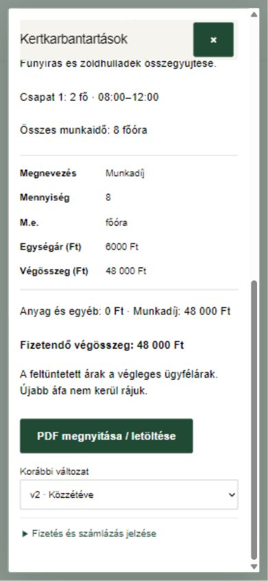

# Kertkarbantartási munkalap és elszámolás

ERP 0.12.0 · 2026. november 4. · A fejlesztői PDF 18. fejezete és a jóváhagyott pontosítások alapján.

## Rövid kipróbálás az irodának

1. Nyisd meg az [ERP-t](https://agnesgeller.github.io/erp/), frissíts, majd lépj be a saját irodai fiókoddal.
2. A felső **Kertkarbantartások** gombbal nyisd meg a modult. Válassz munkát a lenyíló listából; névre vagy címre ékezet nélkül is kereshetsz.
3. Új munkát az **Ügyfelek** résznél, a megfelelő munkavégzési címhez hozz létre kertkarbantartásként. A függő igényt az iroda egyeztetett munkanappal hagyja jóvá. A munkatársi megbízást a meglévő irodai megbízáskezelésben add meg.
4. Válaszd az **Új napi karbantartási munkalap** gombot. Add meg a feladatokat, a csapatok létszámát és érkezését–távozását, majd az anyagokat/egyéb tételeket. Legfeljebb három csapat rögzíthető.
5. Nyisd meg a **Munkalap mentési előnézete** részt, ellenőrizd, pipáld be az adatellenőrzést, és ments piszkozatot. A **PDF megnyitása / letöltése** bármely mentett változatnál elérhető.
6. Az **Árak ellenőrzése és közzététel** teljes áras előnézetet mutat. Ellenőrizd az árakat, pipáld be a megerősítést, majd válaszd a **Közzététel az ügyfélnek** gombot. Ettől a jogosult ügyfél már látja a lapot.
7. Fizetésnél a munkalapon rögzíthető készpénzátvétel vagy átutalási jelzés, teljes vagy részösszeggel. Ez még nem igazolt befizetés. Az iroda a **Karbantartás pénzügyei** résznél, a jelzéshez kapcsolva igazolja a ténylegesen beérkezett pénzt.

## Ügyfél és munkatárs

A megrendelő a saját ERP-fiókjában, a **Kertkarbantartások** alatt csak az iroda által kijelölt címeihez tartozó munkákat és közzétett munkalapokat látja. PDF-et menthet, fizetést és számlázási adatokat jelezhet; új karbantartást vagy visszahívást kérhet. A kért nap még nem foglalás: irodai visszaigazolás szükséges.

A Karbantartásvezető csak érvényes megbízással szerkeszthet és tehet közzé. Meglévő egységárat az iroda módosíthat. **Egyéb** tételnél a vezető megadhat saját nevet, mértékegységet és árat. A dolgozói nézet mennyiséget és időt mutat, árakat nem. Munkaválasztás nélküli vezetői árlistához is érvényes vezetői megbízás szükséges.

## Árak, javítás és pénzügy

- A Munkalap árlistájának 83 tételét kezdeti, csak olvasásos másolással vettük át a védett ERP-adatbázisba. 82 aktív, ebből 57 ellenőrzött; 25 aktív ár irodai ellenőrzésre vár. Az ERP **Karbantartási árlista** részében ellenőrizhetők. Árlista és ügyféladat nincs a GitHubon.
- Ezek végleges ügyfélárak: újabb áfa nem kerül rájuk. Az ERP nem talál ki nettó/áfa-megbontást. A munkalap nem adóügyi számla.
- A csapatidő és a sorok számítása pontos; a megjelenítés legfeljebb két tizedes, fölösleges nullák nélkül. A pénzösszeg csak az összesített pontos értékből kerekítődik.
- **Javítás új változatként**: az előző változat megmarad. Az új piszkozat közzétételig nem cseréli le az ügyfél korábbi PDF-jét, és nem módosítja az egyenleget.
- A szerkesztőben **Visszavonás / Újra** használható. Mentett munkalap indokkal visszavonható, az iroda indokkal helyreállíthatja. Az előzmények és az igazolt pénz megmaradnak.
- A közzétett aktív munkalap egyszer számít az elszámolásba; visszavonása az elszámolható összeget módosítja. Egyetlen fizetési jelzés sem könyvel automatikusan bevételt a régi Kasszába.
- A részben igazolt jelzésnél látszik az irodán igazolt összeg. Igazolt pénz javítása a Pénzügyek elleneseményével történik. A kertépítési eredmény- és jutalékzárás nem vonatkozik a karbantartásra.

Az ablak jobb felső **×** gombbal és Esc-pel bezárható; folyamatban lévő mentés végét meg kell várni. Internet nélkül munkalappiszkozat tárolható az adott eszközön, közzététel nem történik. Bizonytalan mentés az eredeti kéréssel újrapróbálható. Ügyféladatot tartalmazó helyi piszkozatot csak megbízható eszközön használj.

## Fejlesztési és átadási határ

Kilenc saját ERP-tábla, két saját ERP-trigger és csak a hitelesített ERP-kiszolgáló számára elérhető RPC-k készültek. Az előzménytáblák közvetlen módosítása minden alkalmazásszerep számára tiltott; az API csak új előzményt fűz hozzá. Más alkalmazás, régi Auth vagy meglévő forrásadat nem módosult. Új előfizetés és Supabase-fájltároló nem készült.

A régi munkalapok/elszámolások teljes történeti átvétele külön ellenőrzött átállási feladat. A teljes Napi feladatok/naptári kapacitásfoglalás és a teljes ERP közös üzleti átadása még hátravan. Az új modulhoz éles próbamunkalapot vagy pénzmozgást a fejlesztés nem hozott létre.

