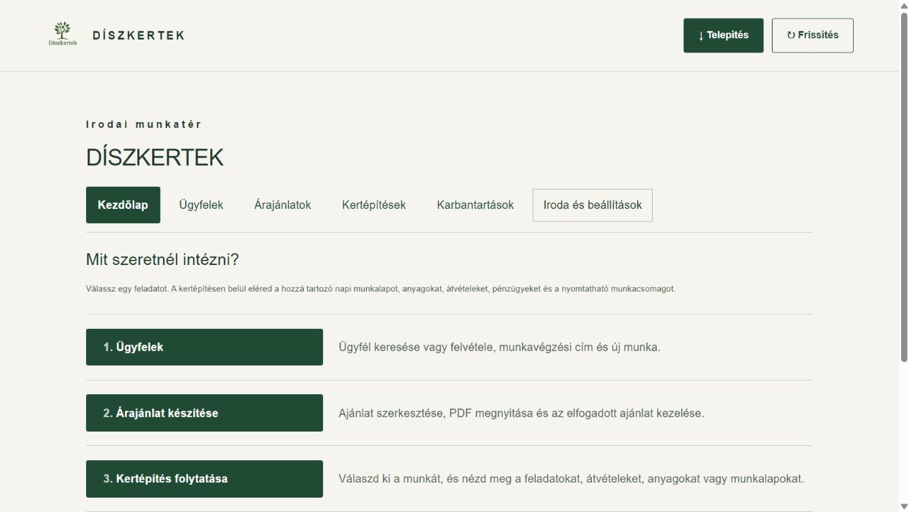
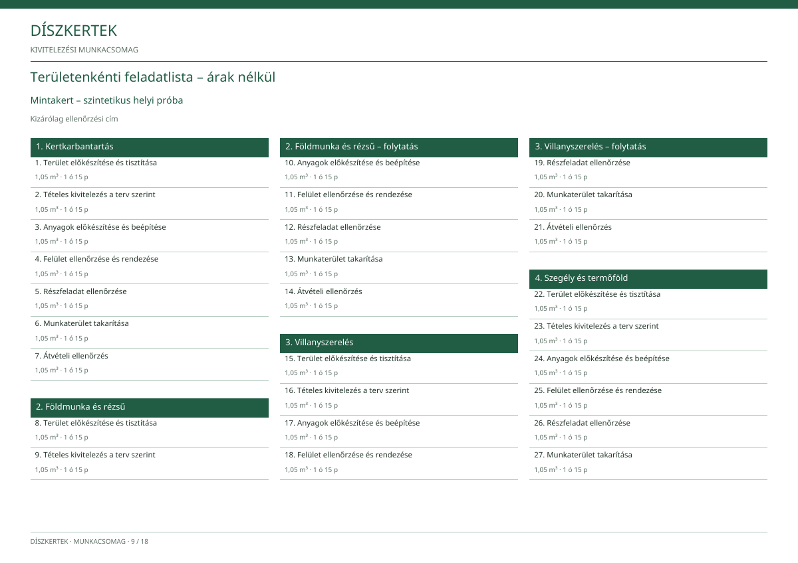

# Munkacsomag és egyszerűbb kezelőfelület

ERP 0.13.0 – 2026. november 4.

## Rövid kipróbálás

1. Frissítsd az alkalmazást, majd lépj be irodai jogosultsággal.
2. A kezdőlapon válaszd a **Kertépítés folytatása** lehetőséget, majd a kertépítést. A munkának elfogadott ajánlatból indított munkatervvel kell rendelkeznie.
3. A **Feladatok és átvétel** nézetben nyisd meg a kívánt munkarészt. Az **Előrehaladás és munkaidő** és az **Előzmények és statisztika** külön gombon érhető el.
4. A **Munkacsomag / PDF** gombbal válassz címzettet, csapatcsomagnál a kitöltendő napok számát, majd kattints a **Munkacsomag elkészítése** gombra.
5. A kész PDF megnézhető és letölthető. A jobb felső **×** és az Esc bezárja az ablakot. A csomag nem küld levelet és nem módosít adatot.

## Melyik csomag kinek szól?

- **Munkatársaknak:** sorrend és függőségek, négyszintű átvétel, részfeladatok, háromoszlopos területlista, változások, anyagok, mozgások és jogosultság szerinti tényleges munkaidő; árak nélkül.
- **Megrendelőnek:** kizárólag saját munkája, engedélyezett feladatok és beépített anyagok, saját ügyfélárak és befizetések. Nincs belső eredmény, beszerzési ár vagy dolgozónkénti munkalap.
- **Belső irodai eredménylap:** külön dokumentum, kizárólag irodának; a meglévő eredmény- és jutalékszámítás adataival. Ne küldjétek az ügyfélnek vagy a csapatnak.

A kitöltendő napi lapokon oldalanként öt nap, naponként három csapat, öt leszállított és öt beépített anyagsor szerepel. Ezek üres papírlapok: kitöltésük nem ment automatikusan az ERP-be.

A zöld-fehér szerkezet a Kiss Csaba-munkacsomag mintáját követi. Az üzleti működés továbbra is az eredeti fejlesztői PDF-é: minden feladatnál négy valódi átvételi szint marad. A magasabb elfogadás nem hoz létre hiányzó alsó pipát; a befizetéshez külön irodai igazolás kell.

## Kevesebb menüpont egyszerre

A kezdőlap négy útja: **Ügyfelek**, **Árajánlat készítése**, **Kertépítés folytatása**, **Karbantartás intézése**. Munkatársak, megbízások, felmérések, árlisták és további irodai műveletek az **Iroda és beállítások** alatt vannak. A munkákon belül három nézet választja szét a feladatokat, előrehaladást és előzményeket. A meglévő funkciók megmaradtak.

## Ellenőrzés és korlátok

463 automatizált teszt, TypeScript-fordítás, kiszolgáló-típusellenőrzés, asztali/mobil böngészőpróba és három PDF vizuális ellenőrzése. A helyi minták kitalált adatokkal készültek; nem valódi ajánlatok. A PDF készítése online történik, a meglévő szerveroldali jogosultságokkal. Közben változó forrásadatnál új készítést kér. Új adatbázistábla, jogosultság, Auth-beállítás, függőség és előfizetés nem készült; más alkalmazást nem módosítottunk. A közös üzleti átadási próba továbbra is szükséges.

## Külön építésvezetői csomag – 0.16.9

Munkaterv → Munkacsomag és PDF → **Építésvezetőnek – műszaki és beszerzési adatok** → Munkacsomag elkészítése. A kijelölt építésvezető saját belépésével is eléri. Az előnézet megnyitható és letölthető. Külön beszerzési áttekintést ad a várható egységárral és beszállítóval, a számára engedélyezett munkaidővel, valamint a közös visszautasítások indoklásával. Az irodai eredmény, jutalék és személyes/irodai bejegyzések kimaradnak. A másik három csomag megmarad.
