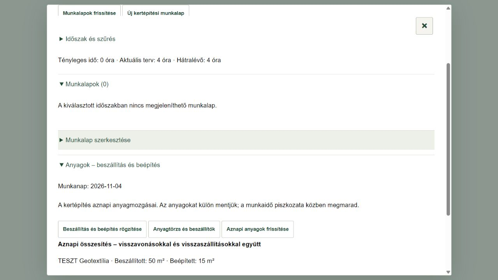

# Kertépítési munkalap és tényleges munkaidő

ERP 0.9.0 · 2026. november 3. · PDF 15. fejezet.

## Munkalap rögzítése

1. Belépés után **Munkaterv és teendők**, majd válaszd ki a kertépítést és az aktív munkaszerepedet.
2. **Munkalapok és munkaidő → Új kertépítési munkalap**. Az iroda és a munka Építésvezetője rögzíthet, kizárólag futó kertépítéshez.
3. Add meg a munkanapot, a közös érkezést/távozást és a munkaleírást. A lenyílóban pipáld ki az aznap dolgozókat. A hiányzó munkatársat az iroda a már meglévő Munkatársak és megbízások felületen rendelheti hozzá a munkához.
4. Eltérő érkezés/távozás esetén nyisd le a dolgozót, jelöld az eltérést és add meg az egyéni időpárt. A magyarázat opcionális. Több munkafázist is pipálhatsz; ettől a dolgozó ideje egyszer számít, nem kell fázisonként percekre bontani.
5. **Mentési előnézet ellenőrzése**, majd **Munkalap mentése**. Az átfedő személyes idő külön figyelmeztetést és megerősítést kér. Ha közben változik az adat, új ellenőrzés szükséges.

Egy személy egyszer szerepelhet a munkalapon. A távozás az érkezés után, ugyanazon a napon legyen; többnapos munka külön napi munkalapokra kerül. Automatikus szünetlevonás nincs. Példa: 7:30–15:30 és 9:00–14:00 = **8 + 5 = 13 emberóra**.

## Javítás és megőrzés

A kiválasztott munkalap javítható. A **Visszavonás / Újra** a helyi szerkesztésben használható; egy korábbi mentett változat is új javítás alapja lehet. Mentés előtt ismét ellenőrzés kell.

A **Munkalap visszavonása** kötelező indokkal kizárja az időt az aktuális összesítésből; nem törli az előzményt. A szűrőben a visszavont munkalapok is megjeleníthetők, és ellenőrzés után visszaállíthatók. A változatok és a tényleges módosító eseménynaplója megmarad. Az ablak felül × gombbal zárható be, mentés közben a bezárás védett.

A helyi piszkozat ugyanazon az eszközön, személyhez/szervezethez/munkához/szerephez kötve folytatható. Offline csak piszkozat készül; éles mentéshez és átfedés-ellenőrzéshez internet kell. Bizonytalan mentésnél **Az eredeti mentés újrapróbálása** ugyanazt a kérést küldi, nem hoz létre új példányt. Másik eszköz a sikeresen mentett szerveradatot a frissítéssel olvassa.

## Az ötödik sáv

Az összes érvényes ERP-munkalap személyes perce / aktuális tervezett emberperc. A 100% feletti felhasználás és a negatív hátralévő idő is látható. Nullás vagy hiányzó tervnél nincs kitalált százalék. Az eredeti tervidő, az ügyfélár és a négy átvételi sáv ettől nem változik. 60 perc = 1 óra; 7 óra = 1 munkanap; 5 munkanap = 1 munkahét.

Az iroda és a vezető a projekt munkalapjait láthatja. A dolgozó csak a saját jelenléti sorait és korábbi saját változatait kapja; a többiek idejéből csak összesített értéket lát. A **Saját rögzített munkaidő** a projektről kilépés után is megőrzi a saját napi összesítést. A megrendelő kizárólag a számára engedélyezett kertépítés összesített időmutatóját látja, személyes jelenléti adatot nem.

A kiválasztott, jogosultság szerint szűrt változat CSV/JSON formában letölthető, és **Nyomtatás / mentés PDF-ként** gombbal menthető. Ezek a fájlok helyben maradnak. Ez a modul még nem pénzügyi könyvelés, dolgozói bérszámítás vagy karbantartási elszámolás; régi munkalapokat nem importál és más alkalmazást nem módosít.

[Az elfogadott műszaki terv](munkalap-munkaido-terv.md)

## Munkanapi anyagok – 0.14.1

A kertépítés **Napi munkalap** ablakában nyiss meg egy munkalapot, vagy válaszd az **Új kertépítési munkalap** gombot. Add meg a munkanapot, majd nyisd le az **Anyagok – beszállítás és beépítés** részt.

- Az adott kertépítés kiválasztott napján beszállított és beépített mennyiségek, valamint a rögzítők és a korrekciók jelennek meg. A telephelyi átvétel nem helyszíni beszállítás. Százon túli napló is lapozható; a részösszesítés egyértelműen jelzett.
- **Beszállítás és beépítés rögzítése**: az adott munkát és napot nyitja meg a meglévő anyagkezelőben. Válassz anyagot/szállítmányt, műveletet, mennyiséget; ellenőrzött előnézet után külön mentsd. A készlet továbbra sem lehet negatív. Új részszállítmány külön felvehető.
- **Anyagtörzs és beszállítók**: közvetlen irodai elérés. A dolgozó műszaki anyagadatot tekinthet meg; a meglévő jogosultságok változatlanok.
- Az anyagmentés után az összesítő frissül, a munkaidőpiszkozat megmarad. Az anyagmozgás a kertépítéshez és naphoz tartozik, nem egy dolgozó idősortételéhez: ugyanazon nap több munkalapja nem hoz létre dupla készletmozgást. A munkaidő mentése/visszavonása nem ment és nem von vissza anyagot; azt az anyagnaplóban külön kell intézni.
- Régi munkalapváltozatnál is a nap jelenlegi, korrekciókkal együtt számolt anyagnaplója látszik; ez nem a régi időváltozat befagyasztott anyagmelléklete. A meglévő munkaidő-PDF/CSV/JSON export ebben a javításban nem bővült anyagnaplóval. A részletes anyagkimutatás az anyagkezelő saját letöltésével érhető el.

