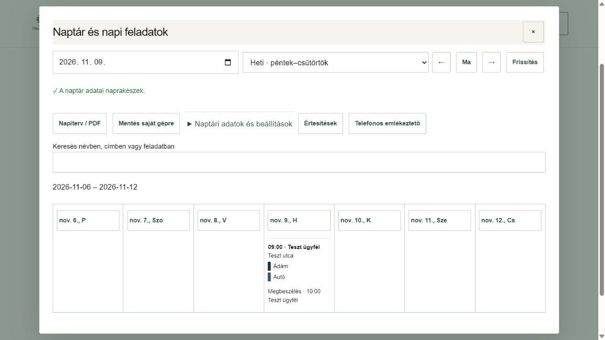

# Naptár és Napi feladatok

ERP 0.14.0 · 2026. november 4.

## Rövid kipróbálás

1. Felül **Frissítés**, majd irodai belépés. Nyisd meg az **Iroda és beállítások → Naptár és napi feladatok** menüt.
2. Válassz napot, **Napi**, **Heti** vagy **Havi** nézetet. A hét péntektől csütörtökig tart. A név/cím/feladat keresése ékezet nélkül is működik.
3. Napi nézetben nyisd le a csapatot vagy az **Előjegyzések** részt. A munkatársak, autók, lépések, eszközmennyiségek, anyagok és elvárások szerkeszthetők. **Napiterv mentése** véglegesít; a helyi módosítás **Visszavonás / Mégis** gombbal javítható. Az **Előzmények** korábbi mentést új változatként állít vissza.
4. **Napiterv / PDF**: válassz csapat- vagy irodai példányt, majd készítsd el. A PDF megnyitható és letölthető. A csapatpéldányban nincsenek személyes előjegyzések és irodai megjegyzések. A levélküldés kézi; a levelező megnyitása után a PDF-et külön csatold, az **Elküldtem** jelzést csak tényleges küldés után használd.
5. **Mentés saját gépre**: nap, hét, hónap, év vagy minden terv ZIP-be menthető, a törzsekkel együtt. Ez az aktuális napi változatokat menti, nem teljes adatbázismentés. Az előzmények az ERP-ben maradnak.
6. Az ablakokat a jobb felső **×** vagy az **Esc** zárja be. Mentetlen szerkesztésnél megerősítést kér. Frissítés előtt mentsd a munkát vagy töltsd le a saját csomagot.

## Régi Napi app és eszközök közötti követés

Az első ellenőrzött átvétel: **40 aktív napiterv, 197 feladat, 16 előjegyzés, 5 törlési jel**; 8 munkatárs, 5 autó, 12 eszköz, 8 anyag és 17 sablon. Ezek időponti darabszámok. A régi munkatárs- és autószínek megmaradtak. A régi appban semmit nem módosítottunk.

Újabb forrásadat átvételéhez: **Naptári adatok és beállítások → Adatok átvétele a Napi appból**. Előnézet után külön véglegesítsd. A két app között egyirányú, indított adatátvétel van: az ERP-ben szerkesztett terv nem kerül vissza a régi Napi appba. Ha ugyanazt közben mindkét helyen módosították, választani kell; nincs csendes felülírás. A régi app gépen maradt, nem szinkronizált adatai saját ZIP/JSON exportjával az **Adatfájl beolvasása** alatt pótolhatók, legfeljebb 6 MB-os csomagból.

Az ERP eszközei ugyanazt a saját adatbázist olvassák; látható, nem szerkesztett nézetben időszakos frissítés is működik. A **Frissítés** kézzel újraolvas. Internet nélkül a már megnyitott adat szerkesztési piszkozat marad; végleges mentés és foglalás online történik. Az ablak bezárása a memóriában megőrzi a piszkozatot, oldal-újratöltés nem tartós offline mentés.

## Kapacitás, hozzáférések és emlékeztetők

Kezdetben **csak az iroda látja a naptárat**. A dolgozói/ügyfélkapcsolók és az ügyfélfoglalás kikapcsolva maradnak. Az iroda a **Kapacitás és kapcsolók** alatt adhat meg munkaablakokat és létszámot, az **Időtiltások** alatt egyszeri/ismétlődő kiesést. A régi feladatokból hiányzó befejezési időket nem találjuk ki: amíg hiányos a beosztás, nincs igazolt foglalható szabad kapacitás. Karbantartásnál az előtte/utána egy óra kizárólag kapacitáspuffer, nem számlázható munkavégzés. Jóváhagyott, napi tervbe osztott foglalást előbb az iroda vesz ki a tervből, utána vonhatja vissza; pénzügyi adatot ez nem töröl.

**Telefonos emlékeztető → Bekapcsolás ezen az eszközön** külön böngészőengedélyt kér. Az eszköz saját beállításai szabályozzák a hangot és megjelenést. A kiszolgáló és jogosultsági próbák sikeresek; valódi telefonos kézbesítést az iroda saját eszközén még ki kell próbálni. Más app feliratkozását nem másoljuk. Új előfizetés nincs.

## Fejlesztői folytatás

A 15 saját tábla és nyolc védett RPC a `database/proposals/erp-calendar.sql` állományban követhető. Két saját trigger kapcsolódik a napitervhez/ERP-karbantartáshoz. A gateway 26., a külön emlékeztető 1. változata települt. A saját percenkénti cron csak esedékes, jogosult eszköznél hív Edge-függvényt; üresjáratban nincs Edge-hívás. Titkok a saját Vault-nevek alatt, a helyi technikai mentések Gitből kizárt `.local` mappában vannak. Közvetlen táblajog nincs; az RLS-policy nélküli INFO-jelzés itt szándékos alapértelmezett tiltás, a szolgáltatói RPC szerveroldalon ellenőrzi a saját ERP-fiókot és szerepet.

500 automatizált teszt, fordítás, edge-típusellenőrzés, külön index-utóellenőrzés, asztali/mobil szerkesztés, ZIP-letöltés, hosszú magyar PDF és jogosultságpróba sikeres. A teljes ERP közös üzleti átadása külön feladat.
