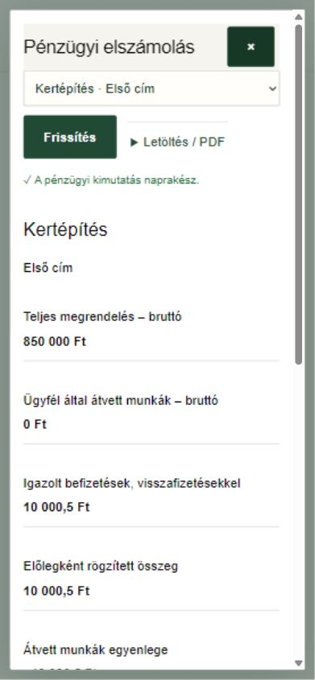

# Pénzügyi elszámolás és jutalék – használat

ERP 0.11.0 · 2026. november 4.

## Megnyitás

Belépés után felül **Pénzügyek**, majd a kertépítés és – dolgozóként – a munkaszerep kiválasztása. Az iroda és a kijelölt címek megrendelője eltérő adatokat lát. A belső eredmény és a jutalék a megrendelőnek soha nem jelenik meg.

Egy meglévő ERP-kertépítésnél az iroda egyszer választja a **Pénzügyi nyilvántartás indítása → Ellenőriztem** műveletet. Ez az aktuális elfogadott ajánlatból és valós ügyfélátvételekből indul. A régi alkalmazásokból nem vesz át pénzmozgást, és nem talál ki korábbi befizetést.

## Mit jelentenek az összegek?

- **Teljes megrendelés:** az aktuális, jóváhagyott ajánlat bruttó végösszege. A lenyitható összetételben a nettó anyagköltség, nettó munkadíj és áfa is megtekinthető.
- **Ügyfél által átvett munkák:** az egyes, megrendelői szinten elfogadott munkafázisok bruttó értéke. Az alacsonyabb pipákat átugró valódi ügyfélátvétel is számít.
- **Igazolt befizetések:** csak az iroda által ténylegesen beérkezettként rögzített pénz, a visszafizetésekkel és elleneseményekkel együtt.
- **Átvett munkák egyenlege:** elszámolható érték mínusz igazolt pénzbeérkezés. Negatív is lehet: az előleg meghaladhatja az eddig átvett munka értékét.
- **Teljes megrendelés egyenlege:** a teljes megrendelés bruttó összege mínusz igazolt befizetések. Az átadás és a fizetettség két külön állapot.

Példa: egy 85 000 Ft-os munkafázist az ügyfél átvesz. Elszámolható 85 000 Ft, befizetett továbbra is 0 Ft. Az iroda 100 000 Ft tényleges előleget igazol: az átvett munkák egyenlege −15 000 Ft. Az ügyfél puszta fizetési jelzése egyik befizetett összeget sem növeli.

## Rögzítés

1. Irodaként **Új pénzügyi tétel / igény**. Választható befizetés, előleg, visszafizetés, fizetési igény vagy számlakiállítási igény. Megrendelőként **Fizetési szándék jelzése**.
2. Bruttó forintösszeg, készpénz/átutalás, valódi pénzmozgás napja, számlázási alany és név. Opcionális számlázási cím, adószám, hivatkozás és megjegyzés. Összegnél pont vagy vessző, illetve ezres szóköz is megadható.
3. **Mentési előnézet ellenőrzése**, majd a konkrét művelet nevét viselő **Ellenőriztem** gomb. A puszta előnézet nem ment.
4. A fizetési igényre a másik fél elfogadással vagy indokolt vitatással válaszol. Saját igény visszavonható. A tényleges pénzt csak az iroda igazolja, részösszegben is; ez az igényhez kapcsolható.

A számlaigény belső ügyintézési kérés, nem jogszabály szerinti kiállított számla. Nincs automatikus banki művelet, e-mail vagy Kassza-könyvelés. Az új modul saját ERP-nyilvántartás; a Kassza és Munkabér külön marad.

## Javítás és átvétel-visszanyitás

A helyi űrlap **Visszavonás / Újra** gombokkal szerkeszthető. A mentett pénztételnél **Tétel visszavonása elleneseménnyel** és indok szükséges; az eredeti sor megmarad. Az ellenesemény visszavonásával visszaállítás is lehetséges. Valódi pénz-visszafizetés külön esemény, nem a korábbi pénzbeérkezés letörlése.

Ha az átvett munkát javításra visszaküldik vagy jóváhagyott ajánlatváltozás történik, az elszámolható érték külön történeti változattal korrigálódik. Az igazolt befizetés megmarad. Az előzményekben a változás összege és ideje visszakereshető.

## Belső eredmény és zárás

Alapból csak iroda látja. Munkaoldal: a tervezett és tényleges emberperc különbsége az ajánlat rögzített kalkulációs óradíjával értékelve. Anyagoldal: az elfogadott ügyfél-ajánlat nettó anyagértékéből levonjuk a tényleges beszerzési költség 100/70/0 szerint elszámolt részét. A két eredmény összege lehet negatív. Ez belső analitika, nem automatikus könyvelés.

Hiányzó tervidő, óradíj vagy tényleges anyagár esetén a számítás hiányos, nem jelenik meg hamis végleges nyereség. **Munka átadva / kertépítés lezárva** csak futó, minden munkafázisában ügyfél által átvett és teljes eredményadatú munkánál rögzíthető. A **Teljes munka kifizetve** külön művelet; elegendő igazolt pénzbeérkezés szükséges hozzá.

A zárási eredmény pillanatképe megmarad. Eltérő későbbi forrásadatnál a felület korrekciót kér; **Zárási eredmény korrigálása** vagy indokolt **Kertépítés újranyitása** használható. Régi zárási pillanatkép nem íródik felül.

## Éves jutalék

Az iroda **Pénzügyi beállítások** alatt külön állítja:

- a belső eredményt láthatja-e a kertész/kertépítő;
- láthatja-e az építésvezető;
- a dolgozó láthatja-e a saját jutalékát;
- jutalékalap: munkaeredmény, anyageredmény vagy mindkettő.

A jutalék akkor is számolódik és naplózódik, amikor dolgozóknak rejtett. A felosztás a kertész/kertépítő szinten ténylegesen jóváírt, munkadíjjal súlyozott részesedést követi; puszta felsőbb ellenőrzésért nem jár végrehajtói rész. Hiányos felosztást külön jelez a program. Nem vezetünk be a PDF-ben nem szereplő jutalékszázalékot vagy automatikus bérlevonást.

**A megrendelő külön döntése:** az éven átnyúló kertépítés jutaléka a lezárás évébe számít. Futó munkán előzetes összegként látszik. Minden új év külön indul; a korábbi év negatív egyenlege nem kerül át. A korábbi rögzített elszámolás és kifizetés megmarad.

**Éves jutalék:** évválasztás, személyenkénti összesítő és projektes bontás. Az iroda év végén vagy utána rögzíthet éves elszámolást, majd annak pozitív, még ki nem fizetett részéből igazolt kifizetést. Évközi jutalékelőleg nincs. Korrekció külön eseményként készül; a negatív analitikai összeg nem dolgozói tartozás vagy automatikus munkabérlevonás. A dolgozó kizárólag saját jutalékát láthatja, ha az iroda engedélyezte.

## Biztonság, eszközök és letöltések

Az ablak felül **×** gombbal zárható. Mentetlen adatnál figyelmeztetés van; betöltés megszakítható, folyamatban lévő írásnál a visszajelzést meg kell várni. Internet nélkül nem igazolható befizetés vagy jóváhagyás. A saját személyhez, szervezethez, szerephez és munkához kötött helyi piszkozat segít a folytatásban.

Bizonytalan válasz esetén **Előző mentés újrapróbálása**: ugyanaz a kérés nem könyvel kétszer. Ha közben másik eszközről változott az adat, **Friss adatok betöltése – a beírt adatok megőrzésével**, majd új előnézet szükséges.

**Letöltés / PDF:** friss jogosultság-ellenőrzés után JSON/CSV, illetve külön nyomtatási előnézetből PDF-be mentés. Az éppen betöltött előzményt tartalmazza; régi tételekhez előbb **Korábbi…**. Éves listában is lapozható az előzmény. Jogosultságvesztéskor a következő kérés megtagadja az adatot, nem mutat helyette régi gyorsítótári pénzügyi kimutatást.

Valódi munkán csak megtörtént pénzmozgást rögzíts. A fejlesztői böngészőpróba kizárólag szintetikus, helyi adatokat használt.

