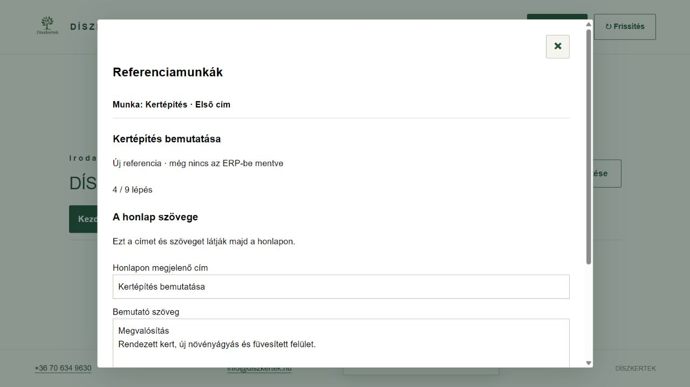

# Referenciamunkák – rövid használat

**ERP 0.16.8.** Iroda és beállítások → Referenciamunkák.

1. Új munkához válaszd ki a kertépítést, majd **Új referencia indítása**. Korábbihoz nyisd le az **ERP-ben mentett referenciák** listát. A félbehagyott munka a **Csak ezen az eszközön lévő szerkesztések** alatt folytatható.
2. Oldalanként egy teendőt kapsz. A munka neve, címe, a referencia megnevezése és mentési állapota végig látható. A **Tovább csak léptet**, a **Vissza** megőrzi a beírtakat.
3. Az előnézetnél a **Referencia mentése az ERP-be** gombbal ments. Ez más eszközön is elérhetővé teszi a szöveget és a képazonosítókat; nem küld semmit a honlapra. Mentés bármikor elérhető a További műveletek alatt is.
4. A tartalom jóváhagyása és a WordPress-piszkozat készítése külön művelet. Automatikus nyilvános közzététel nincs.

A szerkesztésről az eszköz helyreállítási másolatot őriz. Ez **nem ERP-mentés**, és nem kerül a honlapra. Új referencia mindig külön azonosítóval indul; a régi munkát nem folytatja magától. Az ERP-ben mentett elem megnyitása a szerverváltozatot mutatja, a helyi eltérést csak külön Folytatás gombbal lehet megnyitni.

A **További műveletek → Másik munka vagy referencia választása** visszavisz a választóhoz, a beírtakat megőrzi. Ugyanitt található a Facebook-/Instagram-változat, előzmény, Visszavonás/Újra, mentési ZIP és visszaállítható archiválás.

A képcsoportok nyitottsága, a felirat és leírás csoportváltáskor is megmarad. A négy csoport: Előtte, Kivitelezés közben, Elkészült, Későbbi állapot. A fotók az eszközön maradnak; másik eszközre mentési ZIP-pel vihetők át. A Supabase nem tárolja a képfájlokat. Belső árak és munkautasítások nem kerülnek automatikusan a nyilvános változatba.

## WordPress

A valódi hozzáférés- és jogosultságpróba november 6-án sikerült. A WordPress-kapcsolat ellenőrzése csak olvas. A pontos mentett változat irodai jóváhagyása után készülhet piszkozat; siker esetén a Piszkozat előnézete hivatkozás nyílik meg, WordPress-bejelentkezéssel.

A nyilvános közzététel a megjelenés jóváhagyásáig szerveroldalon tiltott. Utána is külön közzétételi gomb és megerősítés kell; nincs automatikus publikálás. A valódi honlapi sablon- és SEO-megjelenés véglegesítése még hátravan. Már a piszkozat képfájljai is hozzáférhetővé válhatnak, ezért a feltöltés előtt a szöveget és a képeket ellenőrizni kell.

Hálózati hibánál a szerkesztés megmarad. Bizonytalan mentésnél a Korábbi mentés ellenőrzése gomb az eredeti kéréssel dolgozik. Más eszköz frissebb szerkesztését nem írjuk felül csendben; az Előzményekből hasonlítható össze. Bizonytalan WordPress-küldést nem ismétlünk vakon.

