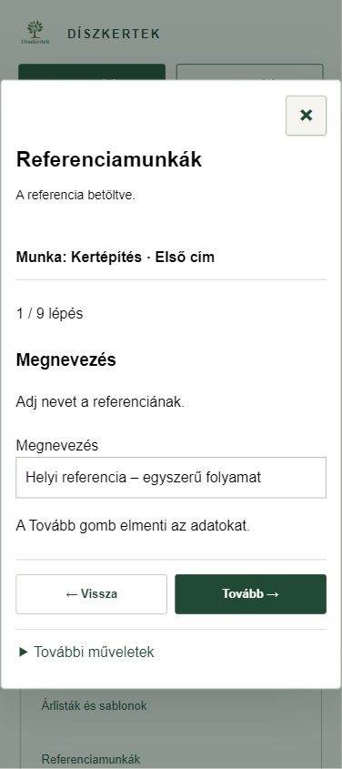

# Referenciamunkák – rövid használat

**ERP 0.16.5.** Iroda és beállítások → Referenciamunkák. Válassz kertépítést, majd Referencia készítése; korábbi munkához a Mentett referenciák nyitható le.

A szerkesztő **oldalanként egy teendőt** mutat. A munka neve és címe minden lépésen látszik. A **Tovább** elmenti az adott szöveget vagy képkijelölést; a **Vissza** megtartja a beírtakat. Nincs hosszú útmutató vagy külön Alap és képek fül.

A Megnevezés után a bemutató szöveg, a fényképek, a honlapszöveg, a keresőbeli megjelenés, a honlap képei, az előnézet és a tartalom jóváhagyása következik. Végül külön gomb készíti el a WordPress-piszkozatot; a kijelölt képeket is ez a művelet tölti fel. A jóváhagyást nem lehet kihagyni.

**Másik munka vagy referencia választása:** a További műveletek alatt, megerősítéssel. A helyi piszkozat megmarad. Ugyanitt található a külön Facebook-/Instagram-változat, az előzmény, a Visszavonás/Újra, a mentési ZIP és a visszaállítható archiválás. Egy platformváltozat szerkesztése nem írja át a többit.

A négy képcsoport: Előtte, Kivitelezés közben, Elkészült, Későbbi állapot. A fotók a saját eszközön maradnak; másik eszközre a mentési ZIP-pel vihetők át. A Supabase nem tárolja a képfájlokat. Belső árak és munkautasítások nem kerülnek automatikusan a nyilvános változatba.

## WordPress

A valódi hozzáférés- és jogosultságpróba november 6-án sikerült. A WordPress-kapcsolat ellenőrzése csak olvas. A pontos mentett változat irodai jóváhagyása után készülhet piszkozat; siker esetén a Piszkozat előnézete hivatkozás nyílik meg, WordPress-bejelentkezéssel.

A nyilvános közzététel a megjelenés jóváhagyásáig szerveroldalon tiltott. Utána is külön közzétételi gomb és megerősítés kell; nincs automatikus publikálás. A valódi honlapi sablon- és SEO-megjelenés véglegesítése még hátravan. Már a piszkozat képfájljai is hozzáférhetővé válhatnak, ezért a feltöltés előtt a szöveget és a képeket ellenőrizni kell.

Hálózati hibánál a szerkesztés megmarad. Bizonytalan mentésnél a Korábbi mentés ellenőrzése gomb az eredeti kéréssel dolgozik. Más eszköz frissebb szerkesztését nem írjuk felül csendben; az Előzményekből hasonlítható össze. Bizonytalan WordPress-küldést nem ismétlünk vakon.

