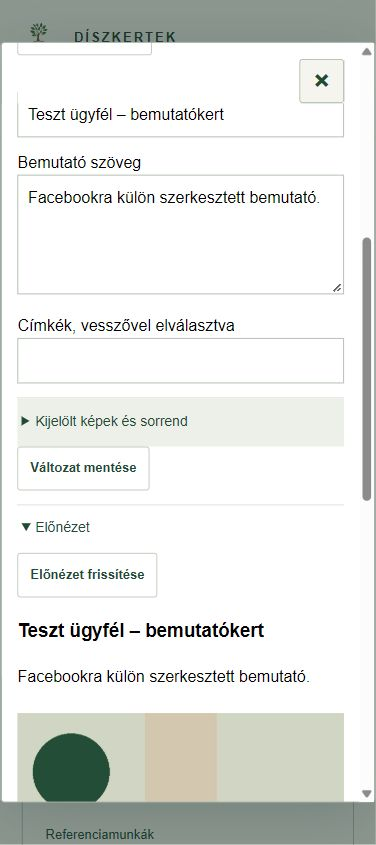

# Referenciamunkák – rövid használat

**ERP 0.16.1.** A referencia-szerkesztő az **Iroda és beállítások → Referenciamunkák** pontban nyílik meg. A fejléc × gombjával bármikor bezárható; mentés közben várd meg a visszajelzést.

1. Válassz meglévő kertépítést, majd **Referencia készítése**. Az alap a kapcsolt felmérésből, ténylegesen átvett munkákból és valóban beépített anyagokból készül. A beszerzett, de be nem épített anyag nem kerül automatikusan bele.
2. Az **Alap és képek** részen nevezd el, javítsd a szöveget, majd **Alap mentése**. A **Forrás ellenőrzése** megmutatja az átvett és még függő munkákat. A friss forrás javaslata külön nyílik meg; a saját szöveget csak kifejezett átvétellel cseréli le.
3. A négy képcsoport: **Előtte / Kivitelezés közben / Elkészült / Későbbi állapot**. Képfájlt választhatsz, vagy a kapcsolt felmérés/projekt helyben elérhető képét veheted át. A fotó optimalizált másolatként kerül a referencia saját helyi tárába; az eredeti forrásfájl megmarad. Adj feliratot és alt szöveget, majd mentsd az alapot.
4. A **Weboldal**, **Facebook**, **Instagram** külön szerkeszthető és menthető változat. A változat elkészítése nem írja át a többit. A képek platformonként külön kijelölhetők és rendezhetők; húzás és fel/le gombok használhatók.
5. Az **Előnézet frissítése** a jelenlegi szerkesztést mutatja. A **Szöveg másolása** és **Posztcsomag letöltése** kézi publikáláshoz használható. A platformcsomag csak az adott változatot és kijelölt képeit tartalmazza; belső árak, munkautasítások és pénzügyi adatok nem kerülnek át automatikusan.
6. A **Saját mentési csomag letöltése** megőrzi az alapot, a külön változatokat és az eszközön elérhető képeket. A hiányzó fájlokat jelzi. Másik eszközön a szöveg a szerverről elérhető, a képek a saját ZIP-ből tölthetők vissza. A képfájlok nem kerülnek Supabase Storage-be.

**Visszavonás / Újra:** az aktuális szerkesztési munkamenetben. **Előzmények:** korábbi alap vagy platformszöveg külön helyi változatként nyitható meg, majd új változatként menthető. **Archiválás:** visszaállítható, a kertépítést, pénzügyet és forrásképeket nem törli. A mentett platformváltozatban használt képet előbb abból kell kivenni és menteni; utána vehető ki az alapból.

Hálózati hibánál a saját piszkozat és az eredeti mentési kérés az eszközön megmarad. Bizonytalan mentésnél **Eredeti kérés újrapróbálása**; frissebb szerveradatnál **Előzmények → Friss szerverpéldány összehasonlítása**. Nem írjuk felül csendben a másik eszköz módosítását. Az első szerveres belépéshez internet szükséges.

## WordPress – külön beállítás szükséges

A referencialista elején a **WordPress-kapcsolat → WordPress-kapcsolat ellenőrzése** gomb már mentett referencia nélkül ellenőrzi a szerveroldali hozzáférést és jogosultságokat. Ez kizárólag olvas; a megjelenés jóváhagyása előtt a képfeltöltés és bejegyzésküldés tiltott.

A közvetlen WordPress-adapter és a védett küldési napló elkészült és helyi szimulátorral tesztelt. **A WordPress-hozzáférés két titka a felhasználó képe szerint mentve van; a valódi hitelesítési és megjelenési próba még hátravan.** A felület ezt jelzi; nincs automatikus közzététel. Biztonságos, kizárólag szerveroldali hozzáférés és a meglévő oldal sablon-/SEO-illesztésének igazolása kell a bekapcsoláshoz.

Bekapcsolás után is: pontos változathoz kötött **irodai ellenőrzés → képfeltöltés → WordPress-piszkozat → külön közzététel**. Név, cím, arc, rendszám és más felismerhető adat csak megfelelő jóváhagyással kerülhet nyilvánosságra. Már a piszkozat képfájljai is hozzáférhetővé válhatnak, ezért ellenőrzés a feltöltés előtt kell. Közben máshol szerkesztett cikket nem írunk felül; bizonytalan küldést nem ismétlünk vakon.

