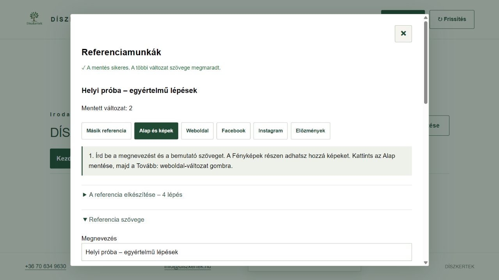

# Referenciamunkák – rövid használat

**ERP 0.16.3.** A referencia-szerkesztő az **Iroda és beállítások → Referenciamunkák** pontban nyílik meg. A fejléc × gombjával bármikor bezárható; mentés közben várd meg a visszajelzést.

**A szerkesztőben négy lépéses útmutató látható.** Az aktív fül zöld; rákattintva a becsukott szerkesztőrész is újra kinyílik. Az **Alap mentése → Tovább: weboldal-változat → Változat készítése → Változat mentése → Tovább: irodai ellenőrzés → Tovább: WordPress-piszkozat** gombok vezetnek végig. A Tovább gomb jelzi, ha előbb mentés vagy ellenőrzés szükséges. Az Iroda és beállítások menü menüpont választása után becsukódik.

1. Válassz meglévő kertépítést, majd **Referencia készítése**. Az alap a kapcsolt felmérésből, ténylegesen átvett munkákból és valóban beépített anyagokból készül. A beszerzett, de be nem épített anyag nem kerül automatikusan bele.
2. Az **Alap és képek** részen nevezd el, javítsd a szöveget, majd **Alap mentése**. A **Forrás ellenőrzése** megmutatja az átvett és még függő munkákat. A friss forrás javaslata külön nyílik meg; a saját szöveget csak kifejezett átvétellel cseréli le.
3. A négy képcsoport: **Előtte / Kivitelezés közben / Elkészült / Későbbi állapot**. Képfájlt választhatsz, vagy a kapcsolt felmérés/projekt helyben elérhető képét veheted át. A fotó optimalizált másolatként kerül a referencia saját helyi tárába; az eredeti forrásfájl megmarad. Adj feliratot és alt szöveget, majd mentsd az alapot.
4. A **Weboldal**, **Facebook**, **Instagram** külön szerkeszthető és menthető változat. A változat elkészítése nem írja át a többit. A képek platformonként külön kijelölhetők és rendezhetők; húzás és fel/le gombok használhatók.
5. Az **Előnézet frissítése** a jelenlegi szerkesztést mutatja. A **Szöveg másolása** és **Posztcsomag letöltése** kézi publikáláshoz használható. A platformcsomag csak az adott változatot és kijelölt képeit tartalmazza; belső árak, munkautasítások és pénzügyi adatok nem kerülnek át automatikusan.
6. A **Saját mentési csomag letöltése** megőrzi az alapot, a külön változatokat és az eszközön elérhető képeket. A hiányzó fájlokat jelzi. Másik eszközön a szöveg a szerverről elérhető, a képek a saját ZIP-ből tölthetők vissza. A képfájlok nem kerülnek Supabase Storage-be.

**Visszavonás / Újra:** az aktuális szerkesztési munkamenetben. **Előzmények:** korábbi alap vagy platformszöveg külön helyi változatként nyitható meg, majd új változatként menthető. **Archiválás:** visszaállítható, a kertépítést, pénzügyet és forrásképeket nem törli. A mentett platformváltozatban használt képet előbb abból kell kivenni és menteni; utána vehető ki az alapból.

Hálózati hibánál a saját piszkozat és az eredeti mentési kérés az eszközön megmarad. Bizonytalan mentésnél **Eredeti kérés újrapróbálása**; frissebb szerveradatnál **Előzmények → Friss szerverpéldány összehasonlítása**. Nem írjuk felül csendben a másik eszköz módosítását. Az első szerveres belépéshez internet szükséges.

## WordPress – külön beállítás szükséges

A referencialista elején a **WordPress-kapcsolat → WordPress-kapcsolat ellenőrzése** gomb mentett referencia nélkül ellenőrzi a hozzáférést. Ez csak olvas. A felhasználó 2026. november 6-án sikeres valódi belépés- és jogosultság-ellenőrzést jelzett.

**Próbapiszkozat, nyilvános közzététel nélkül:**

1. Nyiss meg egy tesztkertépítéshez mentett referenciát. A **Weboldal** változatban töltsd ki és mentsd a szöveget, a SEO-címet és leírást; válaszd ki a bemutatásra engedélyezett képeket.
2. A **Publikálás előtti irodai ellenőrzés** alatt rögzítsd az ellenőrzés/hozzájárulás hivatkozását, pipáld be az ellenőrzést, majd **Irodai ellenőrzés rögzítése**. A jóváhagyás a pontos mentett változathoz kötött.
3. A **WordPress-piszkozat és közzététel** részen előbb **Kijelölt képek feltöltése**, majd **WordPress-piszkozat készítése / frissítése**. Kép nélküli próbánál feltöltés nem szükséges.
4. A sikeres piszkozat naplósorában **Piszkozat előnézete**. Az előnézethez a WordPressben is be kell jelentkezni; ez még nem nyilvános bejegyzés. Ellenőrizni kell a weboldal tényleges sablonját és a SEO-adatokat is.

A nyilvános közzététel a megjelenés jóváhagyásáig szerveroldalon tiltott, a közzétételi gomb addig nem jelenik meg. A megjelenés igazolása után is kizárólag a külön **Közzététel / nyilvános referencia frissítése** gomb és megerősítés indíthatja. Nincs automatikus publikálás. A valódi WordPress-piszkozat megjelenési és SEO-próbája még hátravan.

Név, cím, arc, rendszám és más felismerhető adat csak megfelelő jóváhagyással kerülhet nyilvánosságra. Már a piszkozat képfájljai is hozzáférhetővé válhatnak, ezért az ellenőrzés a feltöltés előtt kell. Közben máshol szerkesztett cikket nem írunk felül; bizonytalan küldést nem ismétlünk vakon. A saját SEO-mentés utáni végső WordPress-állapotot visszaolvassuk, hogy a következő küldés ne jelezze tévesen más szerkesztő módosítását.

