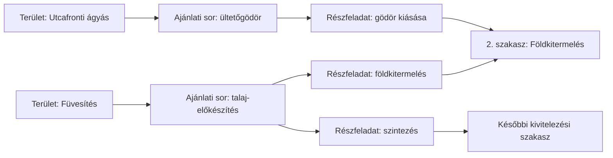

# Szakaszolás és húzással rendezés – részletes terv

2026. november 4. · Kiindulás: ERP 0.14.1, `b05f6c5`.

**Állapot: a felhasználó 2026. november 4-én jóváhagyta a leírás szerinti megvalósítást.** A technikai rész az alábbiakban rögzített; a megvalósítás és az ellenőrzések állapota a fejlesztési naplóban követhető.

## 1. Mit kap az iroda és a csapat?

A meglévő területenkénti tétellista megmarad. Mellé külön kivitelezési szakaszlista készül, amely területeken át csoportosítja az azonos munkafolyamatokat.

- Az árajánlat területe például „Füvesítés” vagy „Utcafronti ágyás”. Ez mutatja, HOL dolgozunk.
- A kivitelezési szakasz például „2. – Földkitermelés”. Ez mutatja, a munka MELYIK MENETÉBEN dolgozunk.
- A részfeladat például „Füvesítés talajának kitermelése” vagy „Ültetőgödör kiásása”. Mindkettő a 2. szakaszba kerülhet, a saját forrásterületének feltüntetésével.

A Kiss Csaba-minta hét szakasza nem rögzített darabszám. A munka saját szakaszokat kap. Az alapbeállításban a kertkarbantartás a nyitó-, a takarítás és levonulás a zárószakasz; üres szakasz elrejthető, de nem kap teljesítési pipát. A többi szakasz száma, neve és feladatai munkánként szerkeszthetők.

## 2. Ellenőrzött jelenlegi működés

Most a `project_tasks` táblában ajánlati soronként egy feladat van; a `(plan_id, source_line_id)` egyedi. A `section` az ajánlati területi csoport neve. A munkaterv mentése a meglévő feladatok sorrendjét, nevét, dátumait és függőségeit módosítja; nem hoz létre tetszőleges számú részfeladatot.

A tényleges átvétel, személyi megosztás és javítás a feladathoz kötött. Ugyanerre a feladatra hivatkozik a munkalap, a változáskezelés és a jutalékszámítás. A pénzügy a teljes ajánlati sor megrendelői átvételét vizsgálja. A munkacsomag jelenlegi szakaszai is a területi csoportokból készülnek.

Ezért nem elég a szakaszcímeket átnevezni. Külön kivitelezési szakasz és részfeladat kell, az eredeti ajánlati kapcsolat megőrzésével. A felmérés a kapcsolódó ERP-forrásra és saját SQL-tervekre korlátozódott; más appot és éles üzleti adatot nem olvastunk ehhez.

## 3. Kategória- és típusszerkesztés

Az **Árlisták és sablonok** alatt külön **Kivitelezési szakaszok** beállítás készül. Egy szakasznak stabil belső azonosítója, sorszáma, neve és aktív állapota lesz. Ugyanahhoz a sorszámhoz az adott változaton belül egyértelmű név tartozik.

Kategóriánként alap munkafolyamat adható meg. A típus szerkesztője ezt átveheti vagy saját listával felülírhatja. A részfolyamat sorában:

- megnevezés és munkavégzési leírás;
- kivitelezési szakasz kiválasztása, a számával és nevével;
- sorrend a típuson belül, előfeltétel és párhuzamosíthatóság;
- munkadíj-súly százalékban, valamint induló időarány;
- műveleti mennyiség forrása: az eredeti sor mennyisége, már kiszámított ismert érték vagy külön, ellenőrzött kézi műszaki mennyiség. Mértékegység-váltást nem találunk ki.

A szakasz kiválasztása lenyíló mező. Az új részfolyamat hozzáadható, kivehető és húzással/fel-le gombbal rendezhető. Egyetlen részfolyamatnál az arány 100%. Több résznél az iroda adja meg az arányokat; automatikusan egyenlő felosztást nem tekintünk szakmailag helyesnek.

A kategóriákhoz stabil tervezési kulcs tartozik; átnevezésük nem szakítja el a régi típusokat. A típusok munkafolyamatadatai az árlista meglévő változataiban maradnak, külön ellenőrzéssel. A közös szakasz- és kategóriaalapok saját változatot kapnak. Változás új ajánlatnál használható, korábbi elfogadott ajánlatot nem ír át.

## 4. Ajánlatból automatikus kivitelezési terv

1. A rendszer az elfogadott ajánlat rögzített változatából olvas, az abban megőrzött munkafolyamat- és szakaszadatokkal. Nem a pillanatnyi árlistával értelmezi újra a régi ajánlatot.
2. Minden ajánlati sor megőrzi saját azonosítóját, területét, mennyiségét, árát, anyagait és eredeti időkeretét.
3. A típus részfolyamataiból részfeladatok keletkeznek. A szakasz azonosítója/sorszáma alapján a különböző területek részfeladatai közös szakaszba kerülnek.
4. A részfeladaton látszik a terület és a forrástétel. A területi listában visszanézhető, mely szakaszokban szerepel ugyanaz az ajánlati sor.
5. Készítés előtt előnézet mutatja a csoportosítást, a hiányzó besorolásokat, arányokat és a körkörös függőségeket. Hiányos terv piszkozatként marad; a csapatnak való végleges közzétételhez rendezni kell.
6. A már létrehozott terv újragenerálása nem dupláz. Az iroda előnézetben választ az új forrássorok átvétele és a saját munkarend megőrzése között.

Régi, munkafolyamat-pillanatkép nélküli ajánlatból induláskor az iroda kifejezetten kiválasztja és jóváhagyja a használt sablonváltozatot. Hiányzó besorolásnál **Besorolásra vár** munkarész jelenik meg; a program nem talál ki szakaszt a magyar tételnév alapján.

## 5. Kézi szerkesztés és húzás

A munkatervben két nézet választható: **Területek szerint** és **Kivitelezési szakaszok szerint**. A területi lista az eredeti kapcsolatok szerinti nézet marad.

Az iroda szakaszt hozhat létre, átnevezhet, átrendezhet, illetve részfeladatot helyezhet át másik szakaszba. A nyitó/záró szakasz alapból a helyén marad; a szerepének módosítása külön, jelzett irodai szerkesztés. A munkafázis áthelyezése nem változtatja meg a forrásterületet.

A fogantyúnál indított húzás megmutatja a célhelyet és a cél szakasznevet. Húzáskor még nincs szervermentés. Az **Elrendezés mentése** egyben, ellenőrzötten véglegesít; előtte **Visszavonás / Újra**, illetve a húzás közben **Esc** használható. A függőségi ellentmondás érthető hiba: például a mulcsozás nem kerülhet a szükséges ültetés elé. Párhuzamos részfeladatok megengedettek; a sorszám nem tiltja automatikusan az egy időben végzett munkát.

Mobilon a fogantyú használata mellett a lista rendesen görgethető. Minden művelethez **Fel / Le / Másik szakaszba** alternatíva és billentyűzetes kezelés készül. A szín és a húzási animáció önmagában nem közölhet információt; a cél szövegesen is látszik.

A közös rendező az alábbi, természetes kézi sorrendű listákban kerül használatba:

- kivitelezési szakaszok és részfeladatok;
- típusok részfolyamatai és szerkeszthető sablonsorok;
- szerkeszthető ajánlatok főtételei és tételsorai;
- a Naptár napi feladatainak és munkalépéseinek listái, a dátumok, emberek, autók és időpontok változtatása nélkül.

Az ügyfél- és munkatárslisták megmaradnak a kért ABC-sorrendben. Elfogadott ajánlat szerződéses tartalmát, pénzügyi eseményt, anyagkészletet és jogosultságot nem lehet húzással megváltoztatni. A Napi feladatokban egy sorrendmódosítás nem küldhet újra már kézbesített, változatlan időpontú emlékeztetőt.

## 6. Árak, idő és teljesítmény – megőrzési szabályok

**Az ajánlati sor továbbra is egyetlen pénzügyi forrás.** A részfeladatok belső munkadíj-súlyainak összege pontosan az adott sor munkadíja, induló időkereteik összege az eredeti tervidő. A pénz két, az idő belül hat tizedesig tárolható; maradékot determinisztikusan osztunk el, az összeg nem csúszhat el kerekítés miatt. Kijelzés legfeljebb két tizedes, szükségtelen nullák nélkül.

Szemléltető példa: egy 100 000 Ft munkadíjú, 600 perces sor két részre bontva 40% és 60% aránnyal 40 000/60 000 Ft súlyt és 240/360 percet kap. A két rész másik szakaszba húzva is összesen 100 000 Ft és 600 perc. Ezek példaértékek, nem tényleges árak.

A munkadíj-súly és az időarány külön megadható; kezdetben az iroda elfogadhatja ugyanazt a felosztást mindkettőre. Későbbi időterv-változtatás naplózott irodai művelet, az eredeti időkeret megmarad. Puszta átrendezés semmilyen ilyen értéket nem módosít.

A négy teljesítménysáv a részfeladatok munkadíj-súlyával számol, a személyek tényleges jóváírásával. A szülő ajánlati sort ugyanakkor nem számoljuk még egyszer. Nullás munkadíjnál nincs nullával osztás; külön darabszámos jelzés lehetséges.

Az ötödik sáv a munkalapok tényleges emberperceiből számol. Egy dolgozó több részfeladatot is kijelölhet anélkül, hogy az időt megsokszoroznánk; percfelosztás továbbra sem kötelező. A meglévő anyagmozgás a kertépítés/nap és az eredeti anyagsor szintjén marad. Ugyanazt a termőföldet nem rendeljük meg és nem számoljuk be újra minden részfeladatnál.

Kézi belső részfeladat felvehető ajánlati kapcsolat nélkül, alapból 0 Ft súllyal és külön megadható, naplózott tervidővel. Fizetős pótmunkához a meglévő kétoldalú változásjóváhagyás szükséges. Tényleges munkaidő és anyagfelhasználás kézi munkalépés esetén is csak a rendes munkalap-/anyagfolyamatban rögzíthető.

## 7. Átvétel, pénzügy és jutalék

Minden részfeladat négy valódi átvételi szintet, indokolt visszautasítást és helyi képhivatkozásokat kap. Áthelyezéskor a részfeladat azonosítója, pipái, résztvevői és naplója megmarad. Szakaszonként összesítő látszik; a szakaszra adott jelölés nem készíthet észrevétlenül sok részfeladat-pipát.

A főnök korábbi pontosításának javasolt szabálya az új működésben: **a megrendelő csak az adott részfeladat érvényes irodai pipája után vehet át**. A belső szintek számított átugrása megmarad, hamis alsó pipák nélkül. Ez a megrendelői kapu tudatos eltérés az eredeti PDF-től, külön része a jóváhagyandó tervnek. A régi, valóban megtörtént megrendelői átvételeket nem töröljük visszamenőleg.

A jelenlegi pénzügy teljes ajánlati soronként tart nyilván átvett összeget. A javaslat ezt megtartja: a sor akkor átvett, ha valamennyi aktív, hozzá tartozó részfeladat érvényes megrendelői átvétellel rendelkezik; korábbi teljes soros átvétel érvényes átállási hivatkozása is figyelembe vehető. Egy részfeladat vagy szakasz pipája nem önálló pénzbefizetés és nem automatikus számla. Új, részfeladat-arányos pénzügyi esedékességet ez a terv nem vezet be.

A jutalék tényleges kertész/kertépítő-szintű jóváírásból számol, a részmunkák belső súlyait csak egyszer veszi figyelembe. Örökölt magasabb szintű teljesítmény önmagában nem lesz dolgozói jutalék. Átrendezéskor a jelenlegi és a már lezárt éves kimutatások nem változhatnak.

## 8. Területi és szakaszos munkacsomag

A jó területenkénti tétellista változatlan forráskapcsolattal megmarad. A külön szakaszos rész az új kivitelezési csoportokat, bennük a területre visszahivatkozó részfeladatokat, időkeretet és négyszintű átvételt mutatja. A PDF ugyanazt a mentett elrendezésváltozatot használja, mint a digitális nézet.

A jelenlegi szerepszűrést minden új részfeladatra is érvényesítjük; belső pénzügyi adat nem kerül a kertépítői/ügyfélpéldányba. A PDF hosszú nevekkel és sok részfeladattal is ismétlődő fejléccel és értelmes oldaltöréssel készül.

A teljes főnöki kéréscsomagból külön feladat marad a negyedik, önálló építésvezetői csomag, a jutalékra fordított százalék, a központi földtérfogat-szorzó és a dolgozói színbeállítás külön kezelőfelülete. Ezek továbbra is a teljes ERP befejezéséhez tartoznak; jelen jóváhagyás a szakaszolásra, rendezésre és a fenti kapcsolódó átvételi kapura vonatkozik.

## 9. Adatbázis – hét új, kizárólag ERP-nyilvántartás

A meglévő ajánlati szülőfeladat és azonosítói megmaradnak. Hét új tábla készül:

1. **execution_catalog_versions:** szervezeti, megváltoztathatatlan változat a szakaszokról, stabil kategóriakulcsokról és kategóriaalap-folyamatokról. Szervezet/változat egyedi; szerző, időpont és tartalomlenyomat.
2. **execution_stages:** tervhez tartozó szakasz, saját azonosító, eredeti katalóguskulcs, helyi név és sorszám, nyitó/záró szerep és aktív állapot. Szervezet/terv szerinti kapcsolatok, nem puszta névegyezés.
3. **execution_parts:** részfeladat, eredeti ajánlati szülőfeladat, sablonrész-azonosító, szakasz, sorrend, leírás, műszaki mennyiség/egység, munkadíj-súly, eredeti/aktuális perc, revízió és négyszintű állapot. Belső kézi lépésnél nincs árazott szülő. Régi átvételi alapra külön hivatkozás mutat, nem hamis új pipa.
4. **execution_dependencies:** terven belüli részfeladat-előfeltételek. Önhivatkozás, idegen terv és kör tiltott; a szakaszba sorolás önmagában nem függőségi él.
5. **execution_events:** csak bővülő eseménynapló; actor, szerep, indok, médiaazonosítók, régi/új állapot és idempotens kérésazonosító/lenyomat. Szervezeti kérésazonosító nem használható eltérő tartalomra vagy másik szereplővel.
6. **execution_layout_versions:** megőrzött szerkezeti változat, felhasznált ajánlat-/katalógusváltozat, szakasz- és részfeladatkiosztás, számított ellenőrzőösszegek, valamint az átálláskori régi állapot forráshivatkozásai. Teljes szerkezeti mentéskor készül, nem minden felületfrissítéskor.
7. **construction_worksheet_part_links:** aktuális munkalap/dolgozó/részfeladat kapcsolatok. A munkalapváltozat JSON-pillanatképe a régi és az új kijelöléseket is megőrzi. A munkalap időtartamát továbbra is egyetlen dolgozói sor számolja.

A `workplans` saját kiegészítő mezői jelzik a régi/új végrehajtási módot és szerkezeti revíziót. A meglévő árlista-/ajánlatváltozatok JSON-dokumentumai kapják az ellenőrzött munkafolyamat-pillanatképet. A meglévő `project_tasks.section` továbbra is a forrásterület, nem írjuk felül a szakasz nevével. A `project_tasks` eredeti pénz-/időalapját védő szabály megmarad.

Minden új táblán ENABLE/FORCE RLS és közvetlen alkalmazásszerepi tiltás. A szervezeti összetett idegen kulcsok és a hivatkozási/lapozási indexek a terv-, szülőfeladat-, szakasz-, előfeltétel-, esemény- és munkalapkapcsolatokat fedik. Üzleti előzményre nincs automatikus kaszkádos törlés; hivatkozott szakaszt archiválunk vagy áthelyezési előnézettel ürítünk ki.

## 10. Kiszolgáló és közös számítás

Legfeljebb hét új védett RPC készül: katalógus olvasás/írás; terv olvasás; szerkezeti előnézet/mentés; részfeladat-művelet ellenőrzése/mentése. Az előzmények a tervolvasás lapozható részei. A meglévő gateway ugyanazzal a valódi Auth-/ERP-munkamenet-vizsgálattal hívja őket. A kérésben küldött szerep önmagában nem jogosultság.

A katalógus és szerkezet irodai írás. A részfeladaton a munkán ténylegesen érvényes szereppel lehet jelölni; a megrendelő kizárólag az engedélyezett saját címéhez tartozó részeket látja. Belső árakat a szerver szűr, nem csak a felület rejt el. Új belépési mód, Auth-átalakítás, fizetős szolgáltatás és frontend-framework nem készül.

A szerkezeti írás rövid, tervenként sorosított tranzakció, elvárt revízióval. A szerver ellenőrzi a teljes érintett gráfot, az összes részsúlyt, a forrásváltozatot és a jogosultságokat. Elavult mentés 409-es ütközés; azonos kérés újrapróbálása nem dupláz. Nagy listák lapozhatók; az egyes áthelyezések változást küldenek, nem szükséges az egész munka összes sorát minden húzáskor feltölteni.

Közös ERP-s számítás olvassa a régi feladatot vagy az új aktív részfeladatokat. Ezt kell használnia a teljesítménysávnak, munkacsomagnak, pénzügyi átvettkeretnek és jutaléknak is. Különösen a jelenlegi `finance_contract` és jutaléksúlyozás nem maradhat közvetlenül a szülősor régi állapotára kötve új módú munkánál. A régi és új számítás párhuzamos ellenőrzése megakadályozza a dupla jóváírást.

## 11. Meglévő munkák és változáskezelés

A már futó ERP-munkák induláskor régi módban maradnak. Az iroda külön átállási előnézetet kérhet; automatikus tömeges átállítás nincs.

- A legkisebb átalakítás egy régi feladatból egyetlen, 100%-os részfeladat és új szakasz-hozzárendelés. A valódi régi pipák eredeti rekordjukon maradnak, az új nézet arra hivatkozik.
- Több részre bontásnál a változat megőrzi az eredeti átvételi események és személyi megosztások hivatkozásait. Változatlan munkatartalom esetén ezek számított korábbi átvételi alapot adhatnak; új részfeladat-pipát vagy új jóváhagyói dátumot nem gyártunk. A részletező megmutatja, hogy a teljes eredeti tétellel együtt történt az átvétel.
- Az átállás puszta szerkezeti művelete után egyeznie kell a négy sávnak, a személyi súlyoknak, az eredeti/aktuális időnek, az átvett pénzügyi összegnek és jutalékalapnak. Eltérésnél nem véglegesíthető.
- Korábban irodai pipa nélkül megtörtént megrendelői átvétel megmarad. Új átvételi körben már az új, iroda utáni megrendelői kapu érvényes.
- Tartalom-, mennyiség- vagy egységváltozás a már meglévő jóváhagyott változáskezelésen halad át, és az érintett részeken új átvételi kört indít. Tiszta árváltozásnál a valós pipák megmaradnak, a munkadíj-súly újraszámolása naplózott.
- Régi munkalap időadata és pénzügyi pillanatkép változatlan. Új részfeladat-kijelölés csak új munkalapváltozatban jelenhet meg. Lezárt pénzügyi/éves elszámolás szerkezeti mentéssel nem írható át.
- Bekapcsolt új módú munkát egy régi, gyorsítótárban maradt szerkesztő nem módosíthat a régi írási útvonalon; érthető frissítési jelzés szükséges. A régi módú munkák továbbra is működnek.

A mentett elrendezés visszaállítása új, ellenőrzött változat, nem naplótörlés. Közben megváltozott ajánlatnál vagy új átvételnél előnézet és egyeztetés szükséges. A korábbi tényleges pipák és dokumentumok nem veszhetnek el egy szerkezeti Visszavonás miatt.

## 12. Érintett ERP-modulok és megvalósítási sorrend

1. Saját adatmodell, pontos súly-/időfelosztás, állapot- és gráfellenőrző, migráció és helyi adatbázistesztek.
2. Központi szakaszok és kategóriaalapok; típusszerkesztő részfolyamatai; meglévő árlista-/ajánlatvalidálás és rögzített pillanatképek.
3. Automatikus tervelőnézet, két rendezési nézet, kézi részfeladat, közös húzás/fel-le vezérlő és atomikus mentés.
4. Részfeladatos átvétel, javítás, jogosultság, személyi statisztika, munkalap-kijelölés és előrehaladás; a meglévő helyi képcsatolás használata.
5. Pénzügyi/jutalék olvasási kapcsolat és szerepszűrt PDF; megőrzési ellenőrzések a régi munkák átváltásakor.
6. A közös rendező bekötése az ajánlati/sablon- és Napi-feladat-listákba; ismétlődő emlékeztetők kizárása sorrendváltozásnál.
7. Teljes regresszió, asztali/mobil/billentyűzetes próba, több szerep, hosszú PDF, rövid magyar README és képes használat. Tesztek után kizárólag saját ERP-telepítés és main commit/push.

Fő érintett források: árlista/ajánlat szerkesztő és számítás; munkatervmodell/gateway/SQL; munkalap és annak kapcsolótáblája; bejegyzések jóváhagyott változásalkalmazása; pénzügyi súlyozás; munkacsomagmodell/PDF; Naptár-szerkesztő. A build csak a meglévő ERP TypeScript-fordítóját használja. A működő Munkalap, Kassza, Napi feladatok és Munkabér kódja, adatbázisa és belépése változatlan marad.

## 13. Kötelező ellenőrzések

- Két eltérő terület földkitermelése ugyanabba a 2. szakaszba kerül, a területi lista változatlan.
- Változó számú szakasz, üres nyitó/záró rész, átnevezés és sorszámváltozás; stabil forráskapcsolatok.
- Egy sorból több rész, pontos 100%-os munkadíj-/időfelosztás, kerekítési maradék, nulla munkadíj és ismeretlen eredeti idő; hibás összeg nem menthető.
- Húzás szakaszon belül és másik szakaszba, Esc, Visszavonás/Újra, érintéses görgetés és billentyűzet; érvénytelen függőségi kör visszautasítása.
- Másik szervezet/munka/cím/actor adatának tiltása; kertépítő és ügyfél nem kaphat szerkesztési vagy belső árjogot egy átírt API-kéréssel.
- Négy valódi átvétel, iroda előtti ügyféljelölés tiltása új körben, visszautasítás indokkal és képekkel; a számított jóváírás nem hamis pipa.
- Régi, átvett és még át nem vett munkák átállítása; a valódi előzmény, pénzügyi keret, személyi súly és jutalék azonossága tiszta átrendezés után.
- Munkalap több kijelölt részfeladattal: emberperc nem többszöröződik; anyaglista, szállítás és beépítés nem duplázódik.
- Két eszköz ütköző mentése, elveszett válasz/idempotens újrapróba, részleges hálózati hiba és saját elrendezés visszaállítása.
- Jóváhagyott extra/törlés/árváltozás, régi sablon változtatása, régi ajánlatból indítás; semmi nem írja át csendben az elfogadott szerződést.
- Napi feladatok sorrendjének változása nem módosít időpontot vagy erőforrást, és nem küld újra korábbi emlékeztetőt.
- Szerepszűrt digitális és nyomtatott nézet, magyar ékezetek, sok terület/részfeladat és többoldalas PDF; nincs levágott rész.

E terv önmagában nem tesztelt funkció. A kiinduló 506 teszt a 0.14.1 működéséhez tartozik. Az új működés csak a fentiek sikeres végrehajtása és dokumentálása után jelenthető késznek.

## 14. Jóváhagyás és határok

A felhasználó „Kezd el a megvalósítást a leírás szerint nyugodtan” utasítása a szakaszolás és húzással rendezés megvalósítását engedélyezi. Az ERP-n belüli hét új nyilvántartás, a meglévő saját írási/olvasási kapcsolatok szükséges bővítése és a javasolt irodai munkadíj-/időarányok a fenti működést szolgálják. Az éles telepítést tesztek és visszaellenőrzés előzi meg. Más apphoz írás, Auth-átalakítás, fizetős szolgáltatás és valódi történeti átvételek törlése nincs engedélyezve.
