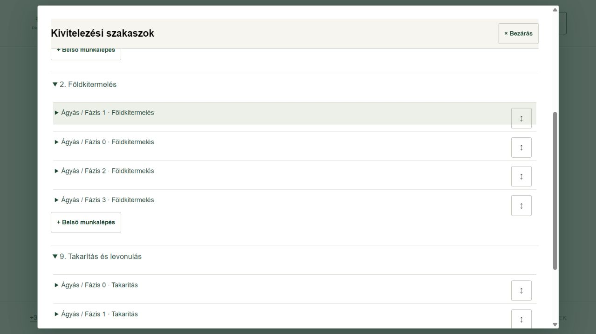
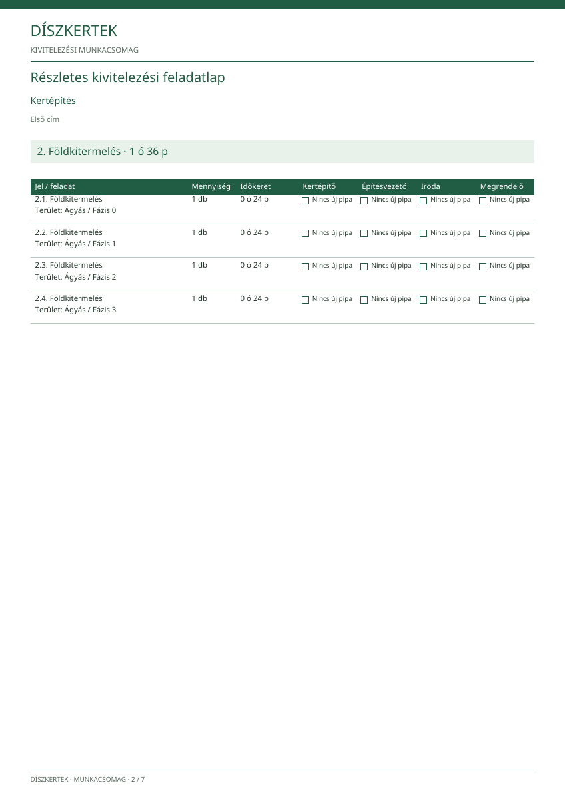

# Kivitelezési szakaszok és rendezés

**Állapot:** helyi kiadásjelölt, 553 sikeres teszttel. Az utolsó mobilos szemrevételezés még nyitott a tesztböngésző elakadása miatt; az új változat még nincs élesítve.

Az ajánlati **terület** és a kivitelezési **szakasz** külön fogalom. Például a füvesítés és az ágyás földkitermelése ugyanabba a 2. szakaszba kerülhet. A területi lista és a szerződéses ár ettől nem változik.

## Rövid kipróbálás

1. Irodai belépés után: **Munkaterv és teendők** → válassz kertépítést → **Iroda**.
2. **Szakaszok alapbeállításai**: add meg a szakaszokat, sorszámukat, a nyitó- és zárószakaszt. A kategória neve egyezzen az árlistában használt névvel.
3. A kategória vagy az árlistatípus **Kivitelezési részfolyamatok** részében add meg a részfolyamatokat, szakaszukat és sorrendjüket. A munkadíj- és időarány külön-külön összesen 100% legyen. A program nem talál ki arányt.
4. A munkánál **Szakaszok és részfeladatok**. Az ajánlathoz mentett részfolyamatokból készül az előnézet. Régi ajánlatnál a jelenlegi alapbeállításokból külön újraszerkesztés választható; ez nem módosítja az ajánlatot.
5. Húzd a **↕** fogantyút a kívánt helyre, akár másik szakaszba. Billentyűzettel a **Feljebb / Lejjebb** és a szakaszválasztó használható. **Visszavonás / Újra** is van. Az előfeltételek nem kerülhetnek későbbi szakaszba, és nem mutathatnak körbe.
6. **Mentés és ellenőrzés**. A szerver összeveti az időkeretet, az átvételi alapokat, a személyi súlyokat és az elszámolható ajánlati sorokat. A régi munkaterv csak sikeres ellenőrzés után vált át.
7. A munkatervben választhatsz **Kivitelezési szakaszok szerint** vagy **Eredeti területek szerint** nézetet. A **Munkacsomag / PDF** külön szakaszos feladatlapot és eredeti területi listát tartalmaz.

**Besorolásra vár:** az iroda még jelölje ki a megfelelő szakaszt. Az üres ideiglenes szakasz kivehető; a nyitó legyen első, a záró utolsó. Jóváhagyott munkatartalom-változásnál az érintett részek új átvételi körbe és ellenőrzendő besorolásba kerülnek.

## Átvétel, munkaidő és pénzügy

- A négy szint megmarad. Az új ügyfélátvételhez előbb az iroda tényleges átvétele szükséges. A visszaküldéshez indok és helyi fotó is kapcsolható.
- Régi, valódi átvétel hivatkozott alapként megmaradhat. Ez **nem új pipa**; a felület és a PDF külön jelzi.
- A napi munkalapon több részfeladat jelölhető egy dolgozóhoz; az emberperce csak egyszer számolódik. A korábbi közzétett munkalapok nem íródnak át.
- Egy ajánlati sor teljes összege akkor válik elszámolhatóvá, amikor minden aktív részfeladatát átvette az ügyfél. A befizetést az iroda továbbra is külön igazolja; nincs automatikus Kassza-könyvelés.
- Puszta árváltozás megőrzi az átvételeket. Munkatartalom-változás új kört indít. A lezárt pénzügyi előzmények megmaradnak.

## További rendezhető listák

Szerkeszthető ajánlatnál a főtételek és sorok, a munkasablon sorai, valamint az ERP-naptár napi feladatai, munkarészei és munkalépései rendezhetők. Az ügyfél- és munkatárslisták ABC-sorrendben maradnak. A rendezés nem küld újra korábbi naptári emlékeztetőt.

## Fejlesztői megjegyzés

A hét saját ERP-tábla és a hét védett művelet részletes leírása a [jóváhagyott tervben](szakaszolas-es-huzassal-rendezes-terv.md) található. A két migráció együtt, egy tranzakcióban telepítendő. A régi munkák alapértelmezésben a korábbi tervmódban maradnak; átállásuk külön, irodai előnézettel történik. Nincs más alkalmazást, Auth-fiókot vagy előfizetést érintő módosítás.

Az önálló negyedik, építésvezetői munkacsomag, a jutalékarány és a központi földtérfogat-ráhagyás külön, még nyilvántartott fejlesztési rész. Ez a szakaszolási kiadás ezeket nem jelenti késznek.
